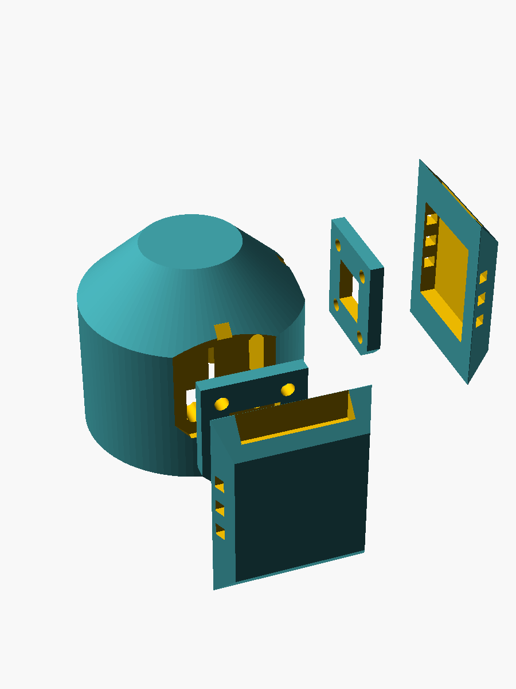
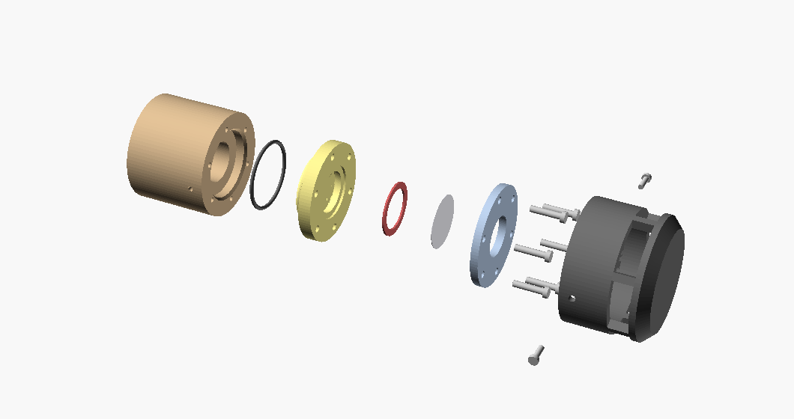
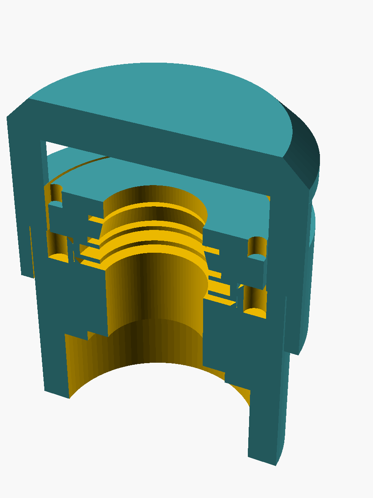

# O₂ probe Rev-A 3D model

This directory contains a superseded parametric mechanical study of the buried
compost oxygen probe. It is retained as enclosure research, not as the current
PCB or ring-carrier source of truth. Its OpenSCAD files still model:

- 32 mm OD / provisionally 28 mm ID enclosure, 129 mm long (modelled as PVC-U
  pipe; the material decision has since moved — see **Enclosure material**
  below);
- the obsolete 20 × 119 × 1 mm PCB envelope and SGX cell location;
- removable PMV15T coupon carrier with PP support grid;
- passive, drained and side-vented diffusion head with a coarse-debris guard;
- cable-end cap with PCB slot and an offset 6.4 mm cable passage.

Run `make all preview` in this directory to regenerate the meshes and preview.
The generated `exports/` directory contains the five individual parts plus a
colour-capable 3MF assembly.

## Model status

This is **not fabrication-release geometry** and must not be used to infer the
current 20 × 107 mm board end, soldered heater ring, or membrane spacing.
Those are controlled by the KiCad project, `PLAN.md`, and a future 1:1 ring/tube
coupon. The tube ID,
129 mm body length, slip fits, membrane active area, carrier pocket, cable bore,
head retention and guard details are provisional interfaces chosen to make a
complete Rev-A fit model.

The enclosure and PCB tip were shortened together by 6 mm. This preserves the
previous 7 mm nominal board-end-to-membrane clearance while reducing the
SGX-cell-centre-to-membrane datum from 38.5 mm to 32.5 mm.

Before printing a functional enclosure, measure and update:

1. actual minimum tube ID and ovality;
2. full populated-PCB front/back swept envelope, coating and potting flash;
3. physical SGX rear port, pin pattern, body standoff and both gas paths;
4. membrane laminate/support/seal stack and required active area;
5. cable OD, water-block termination and potting fixture;
6. head retention, drainage orientation, coupon exchange and compost-cleaning
   access.

The membrane surface in the CAD is visual geometry only. A printed plastic disc
is not a substitute for the specified porous PTFE membrane.

## Membrane fixture — `membrane_fixture.scad`

The qualification step-1 rig, and the origin of the production membrane joint.
`make fixture` builds every part plus the bypass cartridge, the volume-audit
solid and an exploded preview into `exports/`.

**The cartridge is the shared part.** Its seal land, aperture and dry-side
relief are the ones the printed ASA probe head will carry, so the `D_eff` that
step 1 measures transfers to the probe instead of resting on an unstated
"the bench seal behaved like the probe seal" assumption. Only the mounting
changes: here it bolts to a lid, there it bolts into the head.

| Part | Role |
|---|---|
| `cartridge` | Frame with the coupon pocket, 2.5 mm seal land, flared aperture, heater shelf and sensor bore |
| `retainer` | Clamps gasket → coupon → land; 4 × M2.5 |
| `chamber` | Ø49.7 × 21.1 mm puck: Ø18 × 9.8 mm cavity over a flush-mounted cell |
| `lid` | Cartridge seat plus the cavity's gasket face; 4 × M3 |
| `plenum` | Wet-side cap: sweeps the O₂ step across the outer membrane face |
| `die` | Cutting template for the 15 × 15 mm coupon, with the window scribed |
| `plug` | Full-depth blanking pin that turns the gas ports into the leak test |
| `cavity` | Not printed — the connected gas volume as a solid, for measuring |
| `cartridge` + `bypass=true` | **Known-bad part** — a 0.4 mm notch across the seal land, engraved `BYPASS` |

### Thermometry and heater

Both live where they cross **no sealing surface**, which is the constraint that
shapes them. The heater sits on a 2 mm ledge at the aperture mouth, *inside* the
seat gasket's window, and its leads drop into the cavity. The sensor goes in a
Ø3.2 × 6 mm blind bore from the cartridge's −Y edge, stopping 1 mm short of the
seal land — it touches neither face, and it reads the carrier cold spot the
condensation model asks for rather than an average. Both sets of leads leave
through one potted feedthrough in the chamber wall, which is what the probe
does: everything electrical stays on the dry side.

The heater seat is a shelf, not a pocket — bond the ring in. And the sensor bore
is deliberately oversized: set `tsense_bore` to whatever carrier you actually
use.

### The four things the geometry is actually built around

- **Dry-side access.** The aperture flares at 45° immediately behind the coupon,
  so the straight, unflared depth below the membrane is `straight_web = 0`. An
  `assert` refuses any value above 0.25 mm — the outer-cartridge concept in
  `RESPONSE-CANDIDATE-VOLUME.md` failed on 5.8 mm of straight channel, and
  feeding that number to this model reproduces the rejection.
- **A knowable volume, audited against the mesh.** The cell sits in a floor
  pocket with its gas face flush to the cavity floor, so nothing stagnant hides
  under it. The connected volume is **4.91 cm³** — cavity 2.49 plus 2.42 of
  aperture stack above it. That second term is the point: the first version of
  this gate asserted on the cavity cylinder alone and passed at 5.02 while the
  real connected volume was 7.44, half as much again as the budget allows. Build
  `cavity` and measure the mesh; the analytic figure now agrees with it to 0.02 %.
  Both remain **nominal** — the release number is the measured pressure-expansion
  volume.
- **The ports are plugged at the cavity wall, not at the barb tip.** Each bore
  is 27.8 mm long: capping it outside would hang 0.35 cm³ of dead gas off a 5 cm³
  budget, per port. The `plug` pin fills the bore.
- **Metal carries the sealing load.** The retainer screws self-tap into the lid
  boss, which is acceptable in a bench fixture at ≤55 °C and explicitly **not**
  the rule for the buried head — see *Enclosure material* below.
- **One-way assembly.** A chamfered corner keys cartridge, coupon, gasket and
  retainer together. If PMV15T's oleophobic treatment turns out to be one-sided,
  this is what keeps the wet face the wet face.

### Consumables to cut

| Item | Size | Material |
|---|---|---|
| Coupon | 15 × 15 mm, keyed corner | PMV15T (cut on `die`) |
| Membrane gasket | 15 × 15 mm outer, 10 × 10 mm window | 1.0 mm silicone or EPDM sheet |
| Seat gasket | 29 × 29 mm outer, 16 × 16 mm window | same sheet |
| Plenum gasket | 29 × 29 mm outer, 14 × 14 mm window | same sheet |
| Lid gasket | Ø49.7 outer, Ø18 window, clear of the M3 circle | same sheet |

EPDM or silicone, **not FKM** — fluoroelastomers are attacked by ammonia and
amines, which is the wrong direction for this service.

### Fasteners

4 × M2.5 self-tapping ≥ 25 mm (Ø2.1 pilots, blind so no fastener breaks the
lid's sealing face) and 4 × M3 × 35 mm through the body into hex nut traps in
the bottom face.

### Before this is trusted

The printer profile is **unmeasured** (`profile_measured = false`), so every fit
here is a declared default. Print the cell pocket and coupon pocket first and
check them against the real can and a real coupon.
The plenum sweeps 0.78 cm³, about 0.23 s at 200 mL/min — negligible beside the
membrane, but keep it **identical across all four step-1 arms** so it cancels in
the comparison rather than having to be corrected for. Pot the three pin holes and
the can perimeter — they are the fixture's most likely leak path — and then let
the pressure test, not inspection, decide whether the fixture is sound.

## Enclosure material

Decision 2026-09-02, recorded in [`../MEMBRANE.md`](../MEMBRANE.md) under
*Enclosure material: printed ASA*: **bought tube for the potted body, printed
ASA for the head** that carries the keyed cartridges, guard stand-offs and drain
wells. A fully printed body is allowed for prototypes only. The models here are
unchanged by this — they were always printed-part geometry — but three things
now bind anything produced from them:

- **Print for gas-tightness over the gas zone.** Solid wall band, many
  perimeters, no sparse infill touching the cavity, plus a sealing step
  (solvent smoothing or interior epoxy). A printed enclosure is released on the
  measured connected-volume/leak test in
  [`RESPONSE-CANDIDATE-VOLUME.md`](RESPONSE-CANDIDATE-VOLUME.md), never on
  inspection.
- **No sustained strain at temperature.** The tip wall sees ≈79 °C (75 °C pile
  gas + ~4 K heater rise), roughly 7 K under ASA's 1.8 MPa HDT. Retain parts by
  positive features and let a compliant elastomer supply sealing force; do not
  design an interference fit or a preloaded plastic spring.
- **The coupon carrier stays PP.** PP cannot be welded to ASA, so the
  membrane-into-PP weld survives as a cartridge and the cartridge-to-housing
  joint is a compression seal. Model the gasket and retainer, not a fused
  carrier-to-tube interface.

## Response candidate

`o2_probe_response_candidate.scad` is a second, non-release communication model
derived from the lumped response study. It moves the cell toward the board tip,
uses a measured ≤5.0 cm³ local shrouded plenum, and replaces the remote axial disc
with two recessed, supported 10 × 10 mm PMV15T coupons on keyed lower-side facets,
one on each PCB side. The dry membrane face must be ≤0.25 mm from the local cavity.
The gross coupon area is 200 mm²; the design gate is ≥180 mm² measured free
area after supports. Dry-side carrier heaters are shown because the existing
remote cell-island heater cannot be assumed to warm the membrane.

Run `make response-candidate` to produce `exports/response-candidate.3mf` and
`exports/response-candidate-preview.png`. The concept is not printable release
geometry: window sealing, guard retention, board rearrangement, cable-side gas
seal and actual effective volume still require detailed design and measurement.
The two dark end-gasket frames make the required PCB-crossing seals explicit;
one continuous bond/overmould fill closes and displaces the radial shroud/tube annulus
zone. They do not constitute a released seal design. See
`RESPONSE-CANDIDATE-VOLUME.md` for the end-land-corrected approximately
4.99 cm³ first-order connected-void budget and the ≤5.0 cm³ measurement gate. The CAD
also includes one 0.4 mm PP cross support per coupon, representing about
184 mm² projected free area across both 10 × 10 mm apertures.

## Buried head — two variants, one written off

Both built 2026-09-02 to settle the window-placement question on numbers rather
than argument. Measured inputs are `undef` in both and the models **refuse to
render** without them; `make head-provisional` / `make head-end-provisional`
supply documented placeholders so the geometry can be looked at.

| | `o2_probe_head.scad` (radial) | `o2_probe_head_end.scad` (end) |
|---|---|---|
| Status | **written off** | selected |
| Head OD | 46 mm | 42 mm |
| Widest point | 57 mm (guards) | 47 mm (cap) |
| **Connected volume, measured** | **11.21 cm³** | **4.82 cm³** |
| Free area | 200 mm² (two 10 × 10) | 201 mm² (Ø16) |
| Windows | 2, lower quadrants | 1, end face |
| Consumable | 2 coupons 15 × 15 | 1 disc Ø21 |

*Radial — head with two flat facets, a retainer and a slab guard flying outward
from each. The windows are on the sides, which is what forces the thick wall.*

*End — one axis: head, O-ring, PP carrier, retainer, caged cap.*

Regenerate with `make head-provisional` and `make head-end-provisional`, or
`-D 'part="assembly"' -D exploded=true` on either file.

### Why radial is written off

Not a tuning problem — structural. A flat facet wide enough for a cartridge sits
at `sqrt(R² − (cart_w/2)²)` from the axis, so hosting one forces a thick wall,
and **every millimetre of that wall becomes a 16 × 16 mm duct of dead gas behind
the window**: 8.5 mm per port, 4.37 cm³ across two, on a 5.0 cm³ budget. The wall
cannot be thinned without losing the seat land, and the duct cannot be shortened
without moving the window off the side — which is the other variant.

The file now **refuses to render**: its analytic gate counts the port ducts and
cores as well as the bore, reports 10.61 cm³, and points at the end variant.
`-D accept_written_off=true` overrides it, and exists only so the comparison
renders above can be regenerated.

Two further defects were found and are recorded rather than fixed, because the
architecture is dead: the captive nut traps open into a closed Ø24 bore, so they
would print with support that cannot be removed; and the sealing stack was never
completed (no carrier, no gasket, no O-ring).

### Measure the mesh, not the bore

The radial variant's own analytic gate passed at 4.99 cm³ while the mesh measured
11.21. The bench fixture made the same mistake — 5.02 claimed against 7.44 real.
**A bore-only figure is not the connected volume.** Both head files therefore
build a `cavity` part: render it and measure the mesh. The end variant's analytic
figure now counts the spigot bore and flare stack too, giving 4.64 against a
measured 4.82, close enough to actually bite. Both remain nominal; the release
number is the measured pressure-expansion volume.

**And measuring the mesh is still not enough on its own.** `cavity()` is a
hand-built solid, so it measures the void you *intended*. An independent review
found the carrier's O-ring groove and lead-in chamfer were both cut as **centred**
solids rather than annuli, so each bored the gas path out instead of cutting the
spigot's outside. The part had no O-ring groove at all and the real void was
5.55 cm³, 11 % over the limit — while `cavity()`, modelling the intended Ø18 bore,
read a clean 4.82.

The signature was visible the whole time: the carrier rendered as **3 CGAL volumes
with a 2-manifold warning**, from a zero-thickness ring where the leftover skirt
met the spigot. `make head-end-provisional` now fails if any single part renders
as anything but one closed solid (`Volumes: 2` — the body plus the infinite outer
volume), and also renders the non-default `fastening="insert"` route, which
nothing previously built. **Treat a manifold warning as a geometry error, not as
slicer noise.** An outward-facing cut goes through `ring_cut()`.

### The end variant's sealing architecture

Three jobs, deliberately separated:

- **The O-ring seals.** Radial, on the carrier's spigot, squeezed by the
  interference fit against the well bore — cord 1.5, groove root Ø25.02 × 1.95,
  **24 % nominal squeeze**. That 24 % is not a handbook preference: the well is a
  *printed* bore, so what matters is the tolerance band, and 24 % is the value
  that centres it at **±0.22 mm**. At the obvious 20 % the band is −0.34/+0.10,
  and a printed hole errs oversize — the direction that loses the seal. Asserts
  now gate the worst case at both ends (15.5 % at +0.20, 29.2 % at −0.20) and the
  groove fill at 76 % against an 85 % limit. Install stretch is 4.25 %, inside the
  5 % rule. EPDM or silicone, **not FKM** (attacked by ammonia). Because the
  squeeze comes from the fit, no fastener is in the seal load path, so PP creep
  at 75 °C bleeds off retention rather than sealing force. A *face* O-ring was
  evaluated and rejected: it needs a land either side, which pushes the head to
  48 mm — worse than the variant it replaces.
- **The retainer only holds the carrier down.** 4 × M2.5 into heat-set inserts
  on a Ø32.8 circle. Four for symmetry, so the carrier cannot cock and locally
  unload the O-ring; the worst load it ever sees is ~6 N, from a blocked
  membrane plus a cold-to-75 °C excursion.
- **The cap is only a debris guard**, on 2 × M2.5 self-tapping screws in its
  grip, independently replaceable without disturbing the seal. Its front face is
  solid because it is the plowing face; it breathes through a 6-rib cage giving
  **1037 mm², 5.2× the window**. An assert refuses under 4×: a guard more
  restrictive than the membrane sets the response time itself and corrupts the
  `D_eff` being measured.

*Assembled and cut on the axis — the only view that shows the stack closed up.
An exploded view hides the carrier inside the cap. Rendered with
`-D 'part="section"'`.*

### Open on the end variant

1. **It commits cell-orientation option C** (cell past the board end, axis along
   the tube), which `PLAN.md` risk 11 leaves open pending the socket sample
   measurement. This is the decision, not a detail.
2. **Volume is now the binding constraint** — 4.82 cm³ leaves 3.6 % margin, and
   that rides on `cell_axial_len`, still a placeholder.
3. **One window means one fouling event takes the probe out**, where the radial
   pair degraded gracefully. Two smaller windows on the same end face would
   recover this and remains unpriced.
4. The end face only drains if the probe goes in roughly level; a
   downward-tilted insertion turns it into the upward-facing pocket
   `../MEMBRANE.md` forbids.
