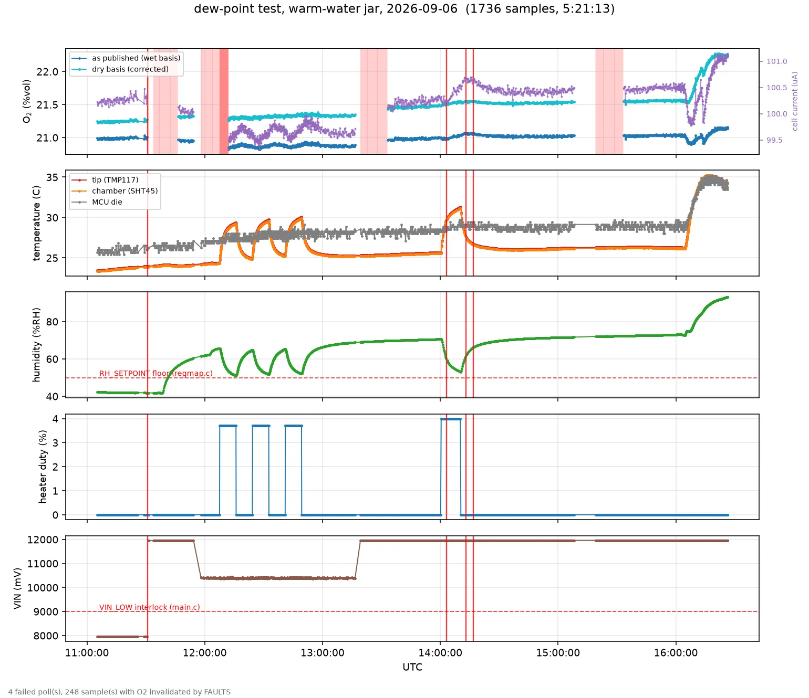

# The dew-margin channel cannot see condensation on the membrane

> **READ THIS FIRST — configuration caveat added 2026-09-06 after review.**
> The article measured here is **not potted, has no tube, and therefore has no
> designed sensor chamber**: the SHT45 and the cell share a volume many times
> larger than the design intends, and the "chamber RH" is a boundary layer
> against a bare PCB rather than a defined gas volume. **None of the numbers
> below are product behaviour.** A potted, tubed chamber couples the gas tightly
> to the board and could largely close the +4.0 K offset that produces the
> effect, which would make the on-PCB proxy serviceable after validation.
>
> What survives configuration: the firmware has **no independent membrane or
> housing temperature**, so it cannot guarantee membrane dew margin in any
> assembly that permits a thermal gradient. That is an observability defect and
> it is real. Everything else here is a bare-board observation awaiting a
> potted, tubed repeat.
>
> Three further corrections from the same review:
>
> * **"Inverts" is too strong.** `T_tip − Td(RH)` still falls monotonically with
>   RH; one operating point cannot establish a reversed response. The honest
>   description is a **false-safe error relative to a colder location**.
> * **`DEW_SUSPECT` is not unable to fire** — the code raises it whenever the
>   computed margin ≤ 0. What it cannot do is protect an independently colder
>   membrane. And it is not a third *interlock*: `DEW_MARGIN` is a metric and
>   `DEW_SUSPECT` its downstream fault, so the "three interlocks" framing
>   overcounts. Two, not three.
> * **The thermocouple measured gas near the membrane, not the membrane
>   surface.** Calling −2.60 K the true margin *at the membrane* assumes equal
>   vapour pressure across the two locations and membrane ≈ gas temperature.
>   Neither was measured.

**Measured 2026-09-06 on the bench. While the probe's membrane was 2.4–2.6 K
BELOW the dew point and visibly in supersaturated gas, `DEW_MARGIN` published
+1.3 to +1.4 K — "safe" — `DEW_SUSPECT` never fired, not even latched in
`faults_ever`, and `o2_trusted` stayed `True` throughout.** The channel does not
merely under-report the condition it exists to detect. It inverts it.

This closes gate 5 of `heater.h`'s bring-up list ("controlled dew-point
crossings") with a negative result.



## 1. The setup

Bare probe suspended in the headspace of an **open-topped glass jar holding
water at 53 °C** (cooling through the run from >60 °C to 47 °C), lid on, still
room air outside, RS485 out through a notched lid. Nothing was flashed and the
heater was disabled for the whole run (`HEATER_DISABLED`, duty 0).

The decisive extra instrument was **an external thermocouple in the gas next to
the membrane**, which is the one measurement the probe itself does not have.

## 2. The measurement

At 16:24:24 UTC, with the probe undisturbed and no fault flags:

| quantity | value |
|---|---:|
| `T_TIP` (TMP117, on the PCB) | 34.53 °C |
| `T_CHAMBER` (SHT45 die, on the PCB) | 34.49 °C |
| MCU die | 34.32 °C |
| **gas at the membrane (external thermocouple)** | **30.5 °C** |
| `RH` as published | 92.51 %RH |
| `DEW_MARGIN` as published | **+1.43 K** |

Derived with the firmware's own Magnus constants (`O2P_MAGNUS_A/B`,
`O2P_MAGNUS_ES0_HPA`, `psychro.h`):

```
p_w                       50.48 hPa
dew point                 33.10 C
firmware margin           +1.43 K   (tip - Td)   -> reports SAFE
independently recomputed  +1.43 K   -> no arithmetic bug
TRUE margin at membrane   -2.60 K   -> CONDENSING
true RH of that gas at 30.5 C   115.9 %          -> SUPERSATURATED
```

**There is no arithmetic error and the dew point is correct.** Dew point is a
property of the gas, and computing it from a T and an RH measured at the same
place is valid. The defect is entirely in the *reference temperature*.

## 3. Why it inverts

`dew_margin = T_TIP − Td(T_CHAMBER, RH)` asks **"is the PCB condensing?"** Both
sensors are on that PCB — the TMP117 and the SHT45 are 6.6 mm apart on the same
copper, and the MCU die a few mm further. The board runs **+4.0 K above the
surrounding gas** on self-heating alone.

So the board is the *warmest* thing in the assembly, and the surfaces that
actually condense — the membrane, the housing, anything at gas temperature —
are the coldest. The channel references the one surface guaranteed not to be
wet, and it will read positive **precisely when** the cooler external surfaces
are wet. Self-heating does not add noise to this measurement; it reverses its
sign.

Two consequences:

- **`DEW_SUSPECT` cannot assert in normal operation.** It needs `margin <= 0`,
  i.e. the PCB below the gas dew point, which self-heating prevents until the
  gas is supersaturated *at board temperature*. Buried in a pile it will
  effectively never fire. Observed here: `faults_ever` remained
  `SETTLING|HEATER_DISABLED` for the entire run.
- **The published RH understates the gas.** The SHT45 measures RH at its own
  elevated die temperature; a warm sensor in humid gas always reads low. It
  published 92.5 % for gas that was at 115.9 % relative to its own temperature.

### This is the third interlock lost to the same root cause

| interlock | status | why |
|---|---|---|
| `O2P_HB_DT_LIMIT` (4.00 K) | inert | tip and chamber are one thermal node; max observed difference +0.220 K across a 5.65 K excursion |
| `DEW_MARGIN` as an RH proxy | degenerate | with `T_TIP ≈ T_CHAMBER` it reduces to `T − Td` at one temperature, a pure function of RH |
| `DEW_SUSPECT` | cannot fire | board self-heats above every surface that condenses |

All three have one cause: **every temperature reference on this probe is on the
same self-heated PCB.** This is not fixable in firmware. Rev B needs a
temperature sensor thermally tied to the membrane or housing and isolated from
board self-heating; without one, no arrangement of the existing channels can
detect condensation where it happens.

## 4. Two O₂ artefacts, opposite signs, both appearing at the crossing

Both began as the true margin went negative. They are separate mechanisms.

### 4a. Surface leakage — current ADDED, slow, tracks RH non-linearly

| window | mean RH | mean `o2_raw` |
|---|---:|---:|
| dry baseline 14:35–15:07 | 71.1 % | 100.424 µA |
| jar | 74.6 % | 100.231 µA |
| jar | 85.1 % | 100.296 µA |
| jar | 90.7 % | **100.896 µA** |

Essentially flat from 74.6 → 85.1 % (+0.07 µA), then **+0.60 µA** over the last
five points of RH. Vapour dilution predicts the opposite sign (about −0.45 %
over that RH change) at constant temperature (35.2 → 34.9 °C), which also rules
out the cell's tempco.

**The knee is the evidence.** Surface conduction on FR4 is negligible until
adsorbed moisture forms a continuous film, then climbs steeply above ~85–90 %RH.
A dilution or electrochemical effect would be smooth and roughly linear in
vapour pressure. Leakage into the WE node is indistinguishable from cell current
at the TIA, so no register can separate them.

This probe has a guard ring on `CELL_WE`. If a few %RH above 90 injects 0.6 µA
into a ~100 µA signal, **the guard is not doing its job** — a Rev B finding, not
a measurement nuisance.

### 4b. Membrane wetting — current REMOVED, transient

```
16:13:18  100.50 uA   level before
16:13:50   99.85       first bottom
16:14:00  100.00       partial recovery
16:14:11   99.83       second bottom
16:15:04  100.28       recovered
```

−0.67 µA, ~80 s, with a double bottom. RH rose smoothly (84.8 → 86.1 %) with no
corresponding feature.

**Rails and digital transport were clean, but this does NOT confirm real cell
current** (corrected 2026-09-06 after review). `afe_vout` and `o2_raw` are
derived from the **same averaged ADS1119 code** (`main.c:475`), so they are not
independent channels and their agreement proves nothing about the analogue
front end. The predicted step is also 4.69 mV for 0.67 µA through 7 kΩ, and the
log moves 967 → 972 mV, not the 971 mV stated below. Steady rails and zero
CRC/I²C errors exclude gross supply and digital-transport failures; they do not
exclude an analogue AFE or ADC transient. Through the dip
`vref` held 2494 mV, `va` 3288–3290 mV, `vin` 11960 mV, `i2c_errs` 0,
`mb_crc_errs` 0. `afe_vout` moved *with* it, 967 → 971 mV: 0.6 µA through the
7 kΩ TIA predicts ~4.2 mV against 4 mV observed. Two independent channels agree.

Current *removed* means less oxygen reaching the electrode, and the fastest way
to do that is liquid water over the diffusion capillary. The double bottom fits
a droplet forming, partially clearing and reforming; electrochemistry drifts
smoothly instead.

**Open question, not yet resolved:** whether the jar was disturbed (lid opened,
thermocouple inserted) around 16:13:50. If it was spontaneous, this is much the
stronger result — condensation throttles the cell unprompted within minutes of
crossing the dew point, with no fault raised and `o2_trusted` still true. Ask
before citing this as spontaneous.

## 5. What this means for a buried probe

At 60 °C and saturation the pile gas is exactly this condition, permanently
rather than for twenty minutes. On current hardware a buried probe would:

- publish a positive dew margin while its membrane is wet;
- never raise `DEW_SUSPECT`;
- keep `o2_trusted` true;
- read high by a slowly growing leakage term that looks like a rising O₂ trend;
- and read low in transient dips that look like anaerobic excursions.

The two artefacts have opposite signs and different timescales, so they will not
cancel and cannot be calibrated out together.

### The heater-only envelope is EMPTY at the worst-case pile point

Found by review, 2026-09-06, and it is the most consequential result in this
document. DS-0637 permits at most **60 °C** and **90 %RH continuous,
non-condensing**. Start from the design's worst case — 60 °C gas at 100 %RH —
and ask what local temperature reduces RH to 90 % by heating alone: about
**62.3 °C** on the firmware's own Magnus curve. That is **above the cell's
temperature rating**, and slightly beyond the fit's stated range as well.

**So neither the main-board heater nor a ring heater can satisfy both ratings
simultaneously at a saturated 60 °C pile.** No amount of heater sizing fixes
this; the two limits close against each other. Resolving it needs one of: a cell
with a different envelope, active water removal rather than heating, or a
reduced pile-temperature specification. **This should be settled before any
respin, because it may decide the cell rather than the heater.**

**The cell is also outside its rated envelope here.** SGX DS-0637 Issue 2 gives
15–90 %RH *non-condensing* for continuous operation (0–99 % short term), and
−40…+60 °C. Saturated pile gas is out of spec by design, which is precisely the
job of the heated membrane: hold the chamber below 90 %RH so the cell stays
inside its rating. Today's thermal numbers say that is plausible — 4 % duty
moved chamber RH 70.5 → 54.7 % — but it has not been demonstrated against a
condensing load. **That is the next test, and it is the one that decides whether
this probe can be buried at all.**

## 6. Sources

- Bench log: `bench-logs/modbus-poll-2026-09-06.csv`, 5 s interval from 15:59:05.
  Plot: `python3 bench-logs/plot_poll.py bench-logs/modbus-poll-2026-09-06.csv --dry-basis -o out.webp`
- External gas temperature: thermocouple, reported by Fab, 30.5 °C at the
  membrane. Not recorded in the CSV — the probe has no gas thermometer.
- Cell limits: `compostlab-literature/datasheets/SGX-OX-ROHS-Mini oxygen sensor
  datasheet DS-0637 Issue 2.pdf`, OPERATING CONDITIONS.
- Firmware: `src/psychro.h` (Magnus constants, and its own note that the fit is
  valid only to ~+60 °C), `src/main.c:325` (margin and `DEW_SUSPECT`),
  `src/heater.h` (gate 5).
