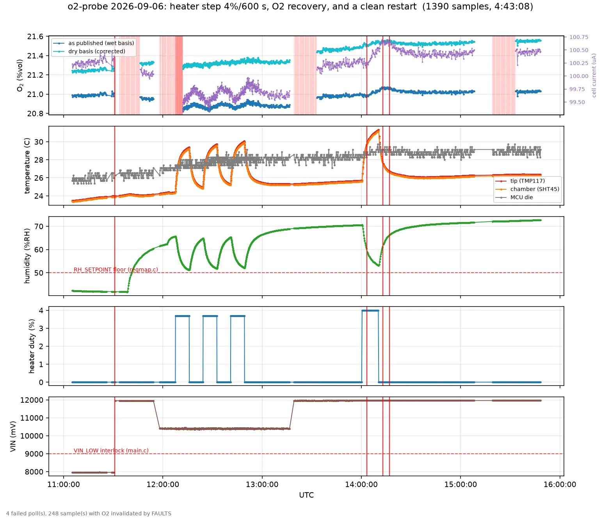

# O₂ is published wet-basis and uncorrected for water vapour

**In a 60 °C pile at 100 %RH the probe will read 16.8 %vol in fully aerated
air.** That is a 20 % relative error, in the direction that looks like the pile
going anaerobic, and it is the exact condition the probe is built for. Nothing
is broken — the cell is reporting the oxygen that is actually there — but what
the register publishes is not the quantity anyone will think it is.

Observed on the bench 2026-09-06 while humidifying a chamber for the thermal
test, and quantified below. This document is the argument and the spec
decision; the implementation is a separate change.

## 1. What was measured

Raising a closed chamber from 42.3 %RH to 63.9 %RH (23.4 → 25.0 °C), with the
probe undisturbed and no fault flags:

```
observed  o2_comp  20.98 -> 20.88 %vol   = -0.48 %
observed  o2_raw  100.20 -> 99.68 uA     = -0.52 %
predicted from vapour dilution alone     = -0.80 %
```

Two things make this a physical result rather than a processing artefact:

* **The raw cell current fell by the same relative amount as the compensated
  value.** A compensation bug would make the two diverge. The `o2_comp`/`o2_raw`
  ratio is unchanged to five significant figures — which incidentally shows
  `TEMPCO_PPM_K` is zero and the temperature correction is doing nothing.
* **The residual is unattributed.** Chamber temperature rose 1.6 K over the
  same window, and at the ~+0.2 %/K these cells show that would be +0.3 %, which
  closes the gap between the −0.8 % predicted and the −0.5 % observed. But a
  single uncontrolled 1.6 K rise cannot *separate* the cell's tempco from the
  TIA, the reference, chamber pressure, equilibration lag, or an error in the RH
  sensor itself — they all move together here. Treat the arithmetic as
  consistent, not as an identification. (Codex review, 2026-09-06.)

## 2. The physics

> **RETRACTED 2026-09-06.** An earlier version of this section asserted that
> the cell responds to the **partial pressure** of oxygen rather than to its
> mole fraction, and built a `P_cal/P_meas` correction on top of that. The
> source cited for it says the opposite — see §3a. The dilution physics below
> is unaffected and stands; it is a statement about mole fractions and never
> needed the partial-pressure premise.

Water vapour is a gas: adding it to a mixture **at constant total pressure**
displaces everything else pro rata. (Constant total pressure is the load-bearing
condition — in a sealed rigid volume the vapour would raise `P` instead and
dilute nothing.)

```
C_wet = C_dry * (P - p_w) / P
```

with `p_w = RH/100 * p_sat(T)` the vapour partial pressure and `P` the total
pressure. `p_sat` is already in the firmware — `psychro.c` computes it with
Sonntag Magnus coefficients for the dew-margin channel, and the same function
serves here.

Dry air is 20.946 %vol O₂ (`O2P_C_AIR`, `o2.h:29`). The same air, saturated —
computed with the **host** helper `o2p_psychro.py`, whose Magnus prefactor is
6.1094, not the firmware's 6.112 (`psychro.h:27`). The two disagree in the
fourth significant figure (firmware: 19.423 / 16.813 / 12.898 for the 40/60/75 °C
rows). These are therefore illustrative values, **not exact firmware test
vectors**; §5's vectors must be generated from `psychro.h` itself:

| condition | p_w | reads | error |
|---|---:|---:|---:|
| 25 °C, 50 %RH | 1.58 kPa | 20.620 %vol | −1.6 % |
| 25 °C, 100 %RH | 3.16 kPa | 20.293 %vol | −3.1 % |
| 40 °C, 100 %RH | 7.36 kPa | 19.424 %vol | −7.3 % |
| **60 °C, 100 %RH** | **19.99 kPa** | **16.815 %vol** | **−19.7 %** |
| 75 °C, 100 %RH | 38.91 kPa | 12.902 %vol | −38.4 % |

`PLAN.md` puts the pile at 40–65 °C, so the middle two rows are the operating
point and the last is the excursion `psychro.h` already warns is outside the
Magnus fit's range.

**The heater does not fix this.** Holding the cell at the 85 %RH setpoint
instead of 100 % removes 15 % of the vapour term, not the term itself: at 60 °C
that is still 17.0 kPa and a 16.8 %vol → 17.4 %vol improvement. The heater
exists to stop the cell drowning, which is a different problem.

## 3. Three separate errors, only one of which is the headline

### 3a. Measurement-time dilution — up to 20 %, the one above

`o2.c` converts cell current straight to a volume fraction with no vapour term.
What comes out is the wet-basis fraction, which is the honest answer to "what
fraction of this gas is oxygen" and the wrong answer to almost every question
anyone will actually ask of a compost probe.

### 3b. Calibration-time vapour — 1–2 %, and it is baked in

`o2.c:47` computes `k = cal_air_na / O2P_LN_AIR`, where `O2P_LN_AIR` is
`ln(1/(1−0.20946))` — the **dry** air value. But the air point is taken in
ambient room air, which is moist. The cell current recorded at calibration
corresponds to the *wet* fraction, and attributing it to the dry one
mis-scales `K` for every subsequent reading:

| air point taken at | true C | K error |
|---|---:|---:|
| 23.4 °C, 42.3 %RH *(this bench)* | 0.2070 | +1.37 % |
| 25 °C, 60 %RH | 0.2055 | +2.15 % |
| 20 °C, 80 %RH | 0.2056 | +2.11 % |

This is not fixed by correcting the measurement — it is a bias in `K` itself,
and it must be fixed at the point the air cal is taken. A probe calibrated in a
damp shed and one calibrated in a dry lab do not agree today, by about 1 %.

### 3c. Total pressure — ±4.2 % from weather at the operating point, unmeasured

**Revised 2026-09-06 after an adversarial review of the implementation.** The
first version of this section said "8 % from altitude" and implied weather
largely cancels. Both halves were wrong in the same way: they quoted
differences in *absolute pressure* as if they were errors in the *published
number*, and they did not notice that `P` enters the calculation twice.

The cell reads `pO₂ = C · P`. Both corrections above need `P`, and **the BMP390
is DNP on Rev A**, so `PRESSURE_HPA` publishes 0 and the firmware uses the
`ASSUMED_P_HPA` config register instead.

```
altitude    0 m -> 101.3 kPa
altitude  715 m ->  93.0 kPa   (-8.2 %)   <- Steingrubenhof, 48.01475N 8.03294E
weather at one site: ~97-104 kPa          (+/- 3.5 %)
```

**Where `P` actually appears.** Twice, and in opposite directions:

1. In `K`. The air point fixes `K = S_air / ln(1/(1−C_cal))`, and `S_air` was
   produced at the calibration pressure, because the cell answers to `pO₂`.
   `K` therefore *carries* `P_cal` inside it.
2. In the dilution factor `P / (P − p_w)` that converts wet basis to dry.

Because the two uses partially cancel, an `ASSUMED_P_HPA` that is simply wrong
by a constant is far less damaging than the 8.2 % suggests. Calibrating **and**
deploying at sea level with the 930 hPa default left in place, air point at
25 °C/50 %RH and read out at 60 °C/100 %RH, publishes about **21.4 %vol, near
+2 % relative** — not 8 % low. (The review computed 21.386 %vol / +2.10 %;
recomputing it here against `psychro.c`'s own Magnus coefficients gives
21.417 %vol / +2.25 %. The two agree on the order and disagree on the last
digit, which is the point: the residual depends on both the calibration and the
measurement conditions, so it is a range and not a constant. Both are about
2 %, and neither is 8 %.)

**Weather does not cancel, and it is the larger error.** `P` moving after the
air point was taken changes the cell's gain without changing `K`. At the same
60 °C/100 %RH operating point, ±3.5 % of weather makes fully aerated air
publish about **20.073–21.813 %vol dry against a true 20.946 — −4.17 % to
+4.14 % relative.** That is the largest uncorrected term left in the oxygen
channel, roughly twice the in-situ altitude residual above, and about a fifth
of the vapour term this document was written about.

**What in-situ calibration does and does not buy.** It cancels the *systematic*
part — a constant offset in the assumed `P` appears in both `K` and the
dilution factor and largely divides out — so in-situ air calibration remains a
requirement rather than a convenience. It does nothing about weather, which
moves `P_meas` after `K` is already fixed.

**RETRACTED 2026-09-06 — do not implement `P_cal/P_meas`.** The argument above
rests on `K` carrying `P_cal` inside it, i.e. on the cell being a partial-pressure
device. The paper cited for that says the opposite. VanderGheynst eq. (3) gives
`D ∝ 1/P`, eq. (8) *defines* `xO₂ = PO₂/P` as the oxygen **mole fraction**, and
eq. (9) is `V = −β₁D'·ln(1 − xO₂)`: the leading `P` of eq. (1) cancels and the
output is a function of mole fraction, near pressure-**independent**. That is the
capillary mass-flow law, the same shape as the SGX datasheet's own
`S = K·ln(1/(1−C))`. Alphasense AAN 009 pp. 1–2 draws exactly this line:
capillary mass-flow cells are nearly pressure-independent, membrane
partial-pressure cells scale with `P`.

So `P` appears **once**, in the dilution factor — not twice — and normalising the
current by `P_cal/P_meas` would inject a pressure error rather than remove one.
VanderGheynst's device is also a heated zirconia FCX-UW (p. 1042), not an SGX
biased liquid-electrolyte cell, so that paper cannot settle the SGX either way.
Reopening this needs an SGX-specific construction or pressure-coefficient
statement, or a controlled pressure sweep at constant mole fraction on this cell.
Until then the pressure work item is **withdrawn**.

**AND THE WITHDRAWAL HAS NOT BEEN PROPAGATED INTO THE FIRMWARE — this is an open
code defect, not a resolved one** (found by review, 2026-09-06; an earlier
version of this paragraph wrongly claimed the firmware never had it). `o2.c`
stores `cal->cal_p_hpa` at the air point and the cell law refers the measured
current back by `P_cal/P_meas`, with a comment that still asserts the retracted
partial-pressure premise. It is a no-op on Rev A **only** because `P_cal` and
`P_meas` both come from `ASSUMED_P_HPA` and are equal; populating the BMP390
activates unsupported behaviour. Either remove the normalisation or obtain an
SGX-specific pressure coefficient before Rev B fits a barometer.
Correcting only the dilution factor against a real barometer reading — which is
what the first implementation of this document did — leaves about **−3.2 % to
+3.2 %** of the weather term on the answer, i.e. it fixes less than a quarter of
it. So the firmware now records `CAL_P_HPA` (`0x0044`) at the moment an air
point is taken and applies that normalisation. With no barometer fitted
`P_meas == P_cal == ASSUMED_P_HPA`, the ratio is exactly 1, and it changes no
number today; it is the structure without which even a populated barometer would
not fix this.

## 4. The decision this needs, which is a spec decision

There are three defensible things `O2_COMP` could publish, and the firmware
must not guess:

1. **Wet-basis** — what it does now. Honest about the gas present. Falls with
   humidity even when aeration is unchanged, which makes the primary channel
   track the weather and the heater duty rather than the pile.
2. **Dry-basis** — oxygen as a fraction of the water-free gas. This is what
   the compost literature means by "O₂ %", and what is comparable across sites
   and seasons. It is also what makes a trend line mean respiration rather than
   humidity.

   **This is now sourced rather than assumed.** Randle & Flegg (1978),
   *Oxygen measurements in a mushroom compost stack*, Scientia Horticulturae
   8:315–323, states the method outright (p. 317): samples were "passed
   through a **cold trap and silica gel indicator to cool and dry the sample**
   before it was passed through a paramagnetic oxygen analyser, Taylor-Servomex
   model OA/250". The gas is desiccated before it reaches the instrument, so
   every percentage in that paper is dry-basis.

   **An earlier draft of this section also argued that the paper corroborates
   itself numerically** — that its outer zone at "about 20 %" and "greater than
   18 %" at 50–60 °C could not have come from a wet-basis instrument. *That
   argument does not hold and has been withdrawn.* Adversarial review read the
   zone-by-zone data it rested on: the outer-**top** region is near 20 % but
   generally **below 30 °C**, and the outer-centre/bottom is above 18 % at
   50–60 °C — where saturated air still reads about 18.4 %. The paper never
   measured RH in those boundary zones, and they are plausibly cooler and drier
   from ambient ventilation. The values are *consistent* with the stated dried
   method; they do not independently prove it. The method statement carries this
   on its own.

   **The independent confirmation comes from other instruments instead**, and
   there are three (§7): Kane & Mullins' Orsat, which is dry-basis *provided it
   is operated the standard way* — Shepherd's NBS description (Res. Paper 266,
   p. 147) saturates the gas before every measurement and equalises temperature
   and pressure, so the vapour cancels out of the volume ratio. Kane names a
   "modified Hays Orsat" (p. 1089) but documents neither the modification nor the
   confining liquid, so for that instrument this is **inference from general
   practice, not source verification** (corrected 2026-09-06). Then Schulze's
   ambient condensate trap, which is *condensed-to-room-temperature* rather than
   dry: the residual is whatever saturation holds at the trap temperature, 2.30 %
   at 20 °C and sea level but ~3.12 % at 25 °C. Schulze states a condensate trap
   (p. 109) and room-temperature analysis (p. 115) but gives neither the room
   temperature nor the outlet RH, so the defensible statement is
   "room-temperature condensate basis, probably near saturation", not a fixed
   2.3 % (corrected 2026-09-06). And — the one that matters most —
   VanderGheynst *et al.* (1997), who built an **in-situ** O₂/RH/temperature probe
   for exactly this environment, calibrated its water-vapour response
   experimentally, published on a dry air basis, and validated against gas
   chromatography. Stated precisely, because an earlier version of this document
   ran two separate tests together (corrected 2026-09-06): sensors stayed
   operational and calibratable after **as many as** 71 days in situ (pp. 1041,
   1049); the GC comparison was a **separate 42-day** test, of which 17 days were
   above 60 °C (p. 1048); and the manual samples were drawn **within 15 cm of**
   the probe rather than from the same gas volume — the authors invoke that
   separation themselves to explain the residual disagreement (pp. 1043, 1048).
   Its oxygen element was a heated zirconia FCX-UW (p. 1042), not an SGX cell, so
   it is a precedent for the *basis convention*, not for this cell's behaviour. The
   convention is not an artefact of sample lines that we are the first to notice
   in situ; someone reporting an in-situ cell in hot saturated gas already made
   the same choice.
3. **Both**, on separate registers.

**Recommendation: publish dry-basis on `O2_COMP` and keep wet-basis available.**
The primary register is the one a Dragino uplinks and a dashboard trends, and a
channel that moves 20 % with temperature is not a channel anyone can act on.
`O2_RAW` already carries the uncorrected cell current, so the raw evidence is
never lost.

Whatever is chosen, the register map's prose must say which basis it is. A
number whose basis is undocumented is worse than either choice.

### The thresholds are on the same basis — but the famous one is not a measurement

**The practically important consequence of this document** is that a probe
publishing wet-basis crosses a 5 %vol alarm line *while the pile still holds
6.2 %vol dry* at 60 °C, flagging anaerobia that is not there. Correcting to
dry-basis puts our register on the same footing as the published numbers, so no
threshold has to be restated as a function of temperature — which is not a thing
anyone will do correctly in a dashboard.

**What must not be claimed is that the thresholds therefore transfer unchanged**,
because the most-quoted one does not survive contact with its own sources. Randle
& Flegg (1978) p. 322 attributes it: "There is evidence (Schulze, 1962; Kane and
Mullins, 1973) that thermophilic organisms are active in compost while the oxygen
concentration remains above 5 %." Both were read (§7):

* **Schulze 1962 does state a 5 % minimum** — corrected 2026-09-06; an earlier
  version of this document claimed he states none. His conclusion (p. 121) reads:
  "The rate of aeration can be controlled by measuring the residual oxygen
  concentration in the exhaust gas. **A minimum of 5 % residual oxygen by volume
  should be maintained.**" What survives of the criticism is narrower and still
  matters: this is a prescriptive *operating* minimum for the mixed **exhaust
  gas** of a 55-gallon drum — the same band he ran experimentally at 5–10 %
  (p. 111) — not a pore-gas figure and not a measured biological floor.
* **Kane & Mullins 1973 does report an O₂ observation** — corrected 2026-09-06;
  an earlier version claimed its only "5 %" was the 95 % N₂ / 5 % CO₂ culture
  mixture. That mixture is present (pp. 1090, 1097), but so is this, on p. 1090:
  "thermogenesis is reduced in the middle zones where the O₂ concentration drops
  below 5 %. It has been reported that insufficient O₂ can result in poor
  thermogenesis." It is an **observational association** in a depth profile, not
  a manipulated-variable experiment — the zone that was low in O₂ also differed
  in temperature, aeration and position — but it is not absent.

So the canonical 5 % is real in the literature, and is an exhaust-gas operating
target plus an observational association. What it has never been is a
manipulated pore-gas threshold. **The figure with an actual
manipulated-variable experiment behind it is Suler & Finstein 1977** — 2 % O₂
severely restricted CO₂ formation, while 10 % performed the same as 18 %. Cite
them for an alarm, and Schulze only for the basis pedigree. Note also what Suler
& Finstein do *not* establish: that 10 % is a universal biological floor. It is
the level at which their system stopped being limited by oxygen.

**Setting the alarm number is therefore out of scope for this document**, which
is about the measurement basis. It needs its own evidence, and the temperature
coupling makes a flat percentage suspect in any case: oxygen is less soluble in
warm water, so a hot pile needs a *higher* gas-phase O₂ to deliver the same
dissolved O₂ to organisms living in wet biofilms.

### What that paper says about the actual goal

Relevant to an operator aiming at a diverse microbiome rather than merely
"not anaerobic" — its conclusion is that oxygen was *not* the limiting factor
(p. 322–323):

> Compost temperatures exceeded 65 °C for much of the time in the inner and
> middle zones which comprise 60 % of the stack volume, indicating that
> **microbial activity was restricted by overheating in the stack rather than
> by lack of oxygen**, a situation which probably occurs widely in commercial
> mushroom production.

Waksman *et al.* (1939) tested discrete temperatures and found the most rapid
decomposition at **50 °C** with thermophilic fungi active there, while at 65 °C
bacteria and actinomycetes predominated and fungi were "seldom found" (p. 97);
75 °C was rejected. So the paper supports useful thermophilic activity **across**
50 and 65 °C with a shifting community, *not* a common 50–65 °C optimum shared by
all three groups — corrected 2026-09-06, an earlier version claimed the latter.
For a diverse microbiome that distinction is the point: 65 °C is already past the
fungi. O₂ exceeded 5 % in 86 % of the stack volume
and 10 % in 79 %, while temperature was out of range in 60 % of it. If that
generalises, **the probe's temperature channel is at least as load-bearing as
its oxygen channel**, and the pairing is what diagnoses a pile — which is an
argument for the diagnostic block being uplinked, not just `O2_COMP`.

Two further observations from the same dataset that bear on deployment:

* **Oxygen varies more horizontally than vertically**, and the inner-bottom
  region sat below 2 %vol continuously while the outer zone stayed near
  ambient. A single buried probe reports its own region, not the stack. Probe
  placement is a measurement decision, not an installation convenience.
* **O₂ and temperature are anti-correlated with a specific, diagnosable
  signature** across a turn: turning cools the pile toward 50 °C, which
  stimulates activity and crashes O₂; O₂ recovers once temperature plateaus
  near 70 °C and activity is suppressed by heat. A probe logging both should
  reproduce that shape, which makes it a field validation target for this
  hardware rather than only a biological observation.

## 5. Proposed change

* Correct the **air point** when it is taken (3b): compute the true `C` at the
  cal-time `T`, `RH` and assumed `P`, and store `K` from that rather than from
  `O2P_LN_AIR`. This is a change at `o2p_o2_calibrate()`, not in the hot path.
* Correct the **measurement** (3a): convert the wet-basis fraction the cell law
  returns into dry-basis with `C_dry = C_wet * P / (P - p_w)`.
* Add a config register for **assumed total pressure** in hPa, defaulting to a
  documented value, used whenever `PRESSURE_HPA` is 0 because the BMP390 is
  DNP. Without it the correction has no `P` at all.
* Reuse `psychro.c`'s saturation-pressure function. Do not add a second Magnus
  implementation — two copies of the same coefficients is how they diverge.

### Guard rules this must obey

The repo's guard checklist applies, and this is a correction that can silently
poison the primary channel:

* **Unevaluable input must not mean "no correction".** If RH or chamber
  temperature is missing or sentinel, the corrected value cannot be computed —
  publish the O₂ sentinel, or a clearly-labelled uncorrected value with a fault
  bit. Falling back to the uncorrected number *while still calling it
  corrected* is the exact failure mode `o2.h` was written to avoid.
* **Monotonicity.** As humidity rises, the correction must not fold back.
  Test at 100 %RH and at 75 °C, not just near room conditions.
* **Bounds.** `p_w` approaching `P` sends the correction to infinity. Above
  ~85 °C at saturation this is no longer a small correction, and the Magnus fit
  is already out of range at 75 °C. Clamp and raise a fault rather than
  publishing a large number.
* **Do not silently change what a stored calibration means.** An existing
  `cal_air_na` was taken under the old assumption. Either migrate it with the
  config version, or require recalibration and say so.

### Test vectors

Every row of the table in §2 is a test vector, plus:

* dry air at 0 %RH — the correction must be exactly a no-op
* the bench observation in §1 — 42.3 → 63.9 %RH must move corrected O₂ by less
  than the measurement noise, where uncorrected moved 0.48 %
* RH sentinel, temperature sentinel, `P` of zero — all must fail closed

## 6. What this does not change

The cell law itself (`S = K·ln(1/(1−C))`, DS-0637) is untouched: it relates
current to the fraction the cell actually sees, and that is still the wet-basis
fraction. Everything here is about what is done with that fraction afterwards,
and about calibrating `K` against the right number in the first place.

## 8. Reproducibility of the O₂ channel: what actually moves it

Measured 2026-09-06 on the bench rig (bare probe, **open** glass jar, wet paper
towel, still room air, 12.0 V). Three disturbances were separated by direct
experiment, and two of the three turned out not to matter.

| disturbance | effect on `o2_raw` | persistence |
|---|---:|---|
| heater excursion, 5.3 K (4 % duty, 600 s) | **+0.3 %** | transient, ~20 min, recovers |
| clean restart, bias MAINTAINED | **+0.03 %** | none — within noise |
| restart accompanying a flash/SWD session | **±0.16 … 0.52 %** | persistent, sign random (n = 5) |



*The canonical five-panel figure. The heater step is the feature at 14:00 — tip
and chamber up 5.3 K, RH falling 70.5 → 54.7 %, duty flat at 4.0 %, VIN steady.
O₂ is drawn on both wet and dry basis. The gap near 15:10 is the bias-interruption
test: the probe was parked in its bootloader for 10 min. **Corrected 2026-09-06
after review: the cell was NOT unbiased.** `AFE_MENB` is active-low and R17
(100 k, `gen_sch.py:690`) holds it there deliberately, so the LMP91000 stays
enabled through MCU reset — `lmp91000.c:9` says so explicitly. The loader
comment claiming "its cell is not biased" is wrong. This measured a **reset
with bias maintained**, which is the weaker claim; a genuine bias interruption
is untested, and DS-0637 warns it can need 15 min of settling. The probe was
then served its 15-minute `SETTLING` window.*

**The heater excursion is real but transient.** +0.3 %, peaking about five
minutes *after* the heater goes off and decaying over ~20 min — two orders of
magnitude slower than the thermal τ, so it is a cell process, not temperature
tracking. It never undershoots. Two confounds were excluded rather than assumed:
absolute humidity *rose* slightly across the step (p_w 23.0 → 24.2 hPa), which
pushes O₂ **down**; and exchange with room air would pull the reading toward
20.95 %vol dry, also **down**. Both point the wrong way, so neither explains it.

**A clean restart does essentially nothing — +0.03 %.** This was measured by
writing `CMD_STAY` (0xB005) to `O2P_REG_UPD_CMD`, which resets the app into the
loader; the loader holds the cell **unbiased** in service mode and calls
`start_application()` after `SERVICE_IDLE_MS` (10 min) with no frames addressed
to the probe. The poller must be stopped for the window or its own traffic
refreshes that idle timer and strands the probe. Nothing is flashed:
`cmd_boot` is gated on a staged image, `cmd_stay` is not.

This is the useful result, and it corrects a working assumption held earlier the
same day. **A restart is not worth ±0.5 %.** The 15-minute `SETTLING` window is
conservative in the right direction and the cell genuinely returns to where it
was. Note also that an MCU reset alone would *not* have tested this: `main.c`
only re-verifies the LMP91000 and skips reconfiguration when the registers read
back intact, so the bias survives a plain reset. Ten minutes in the loader is
what actually drops it.

**What remains unexplained** is the ±0.4 % scatter across the five logged
reboots, since neither a thermal excursion nor a bias interruption produces a
persistent step of that size. What those five have in common is that each
accompanied a **flash or SWD session**, so the candidate is the flash write or
the debug attach disturbing the analog rail or the LMP91000 reference while the
cell is biased. Untested — it needs a stage-and-abort (`CMD_BEGIN` then
`CMD_ABORT`) to get the flash-write disturbance without changing the running
image, which writes to the staging slot and so needs a decision first.

**A fourth disturbance, larger than all of these, is condensation.** Measured
2026-09-06: a slow **+0.6 µA** surface-leakage term appearing above ~85–90 %RH,
and transient **−0.67 µA** dips from liquid water over the diffusion capillary.
Opposite signs, different timescales, so they neither cancel nor calibrate out
together — and the probe raises no fault while either is happening. See
`DEW-MARGIN-IS-BLIND.md`.

**Consequence for use.** Absolute O₂ is reproducible to ~0.03 % across a
restart, ~0.3 % for twenty minutes after a duty change, and to no better than
~0.5 % across a flashing session. Only the ~0.3 % heater transient decays away;
the restart and flashing offsets are **persistent steps**, so any rate window
that straddles one carries the whole step divided by the window length.
Corrected 2026-09-06: the earlier claim that rates are "unaffected by all three"
was wrong. Rates are robust only across windows containing no restart and no
reflash — which is an operational constraint on the product, not a property of
the channel.

## 7. Sources

* Randle, P. and Flegg, P.B. (1978). *Oxygen measurements in a mushroom compost
  stack.* Scientia Horticulturae 8:315–323. Elsevier. Local copy:
  `~/dev/ha/farming/oxygen-mushroom.pdf`. Read in full. The method statement on
  p. 317 is the load-bearing citation for the dry-basis question.
* VanderGheynst, J.S., Walker, L.P. and VanderGheynst, G.B. (1997).
  *Development and analysis of oxygen-sensing probes for in situ monitoring of
  unsaturated solid-state biodegradation processes.* J. Air & Waste Manage.
  Assoc. 47(10):1041–1050. DOI 10.1080/10473289.1997.10464402. **Read in full.**
  The in-situ precedent: an O₂ + RH + temperature probe, water-vapour response
  calibrated experimentally, output published on a dry air basis. Corrected
  2026-09-06 — an earlier version overstated this on two counts. (i) The tests
  are separate: operational/calibratable after **as many as** 71 days in situ
  (pp. 1041, 1049), while the GC comparison was a **42-day** test with 17 days
  above 60 °C (p. 1048), and its manual samples came from **within 15 cm of** the
  probe, not the same gas volume (pp. 1043, 1048). (ii) It is **not**
  architecturally near-identical: its oxygen element is a heated zirconia FCX-UW
  (p. 1042), not a biased liquid-electrolyte three-electrode cell. It is a
  precedent for the dry-basis *convention* and nothing more.
  Its eq. (1) was previously read as writing the cell law over *total* pressure
  and used to justify §3c's `K` normalisation. That reading is **wrong and now
  retracted**: eq. (3) gives `D ∝ 1/P`, eq. (8) defines `xO₂ = PO₂/P` as the
  **mole fraction**, and eq. (9) is `V = −β₁D'·ln(1 − xO₂)`. The pressure
  cancels; the sensor is near pressure-independent.
* Schulze, K.L. (1962). *Continuous thermophilic composting.* Appl. Microbiol.
  10(2):108–122. DOI 10.1128/am.10.2.108-122.1962. **Read in full.** Cited as
  the primary source for the 5 % threshold; it **does contain one** — "A minimum
  of 5 % residual oxygen by volume should be maintained", p. 121 (corrected
  2026-09-06; this entry previously said it did not). It is an operating minimum
  for mixed *exhaust gas*, matching the 5–10 % band he ran at (p. 111), not a
  pore-gas or biological floor. Measured through an ambient condensate water
  trap, so condensed-to-room-temperature rather than dry; the residual vapour
  depends on the unstated trap temperature.
* Kane, B.E. and Mullins, J.T. (1973). *Thermophilic fungi in a municipal waste
  compost system.* Mycologia 65(5):1087–1100. DOI 10.1080/00275514.1973.12019529.
  **Read in full.** The other cited source for the 5 % threshold; it **does
  report one**, as an observational association — "thermogenesis is reduced in
  the middle zones where the O₂ concentration drops below 5 %", p. 1090
  (corrected 2026-09-06; this entry previously said it contained none). Not a
  manipulated-variable experiment: the low-O₂ zone also differed in temperature,
  aeration and depth. Sampled through a **modified** Hays Orsat (p. 1089); a
  standard water-confined Orsat is dry-basis by construction, but the
  modification and confining liquid are undocumented, so treating this as a
  second independent confirmation is inference, not verification.
* Suler, D.J. and Finstein, M.S. (1977). — the figure that *does* rest on a
  manipulated-variable experiment: 2 % O₂ severely restricted CO₂ formation,
  10 % ≈ 18 % (pp. 348–349, confirmed first-hand by the 2026-09-06 review).
  Already in `compostlab-literature`. Still the only manipulated-variable O₂
  figure in the corpus.
* Waksman, S.A., Cordon, T.C. and Hulpoi, N. (1939). *Influence of temperature
  upon the microbiological population and decomposition processes in composts of
  stable manure.* Soil Sci. 47(2):83–114. DOI 10.1097/00010694-193902000-00001.
  Corrected 2026-09-06: does **not** establish a 50–65 °C optimum common to
  fungi, actinomycetes and bacteria. Most rapid decomposition at **50 °C** with
  thermophilic fungi active; at 65 °C bacteria and actinomycetes predominated and
  fungi were "seldom found" (p. 97); 75 °C rejected.
  (Randle & Flegg cite this as 83–98 and as "microbial population"; both are
  wrong — the paper begins on p. 83 and says "MICROBIOLOGICAL".)

All five are archived in `compostlab-literature/` with checksums — see its
`monitoring-control/INDEX.md` and `microbiology/INDEX.md`, which record for each
what it does and does not support.

## 9. THE CORRECTION IS NOT RUNNING ON THE DEVICE (2026-09-06, measured)

Noticed by Fab during the drift-floor soak. Confirmed from the log, without
touching the bus.

**Evidence.** If the dilution correction were live, `o2_comp / o2_raw` would
equal `1 / (K · f)` with `f = (P − p_w)/P`, so the ratio would move with `p_w`.
Across the whole of 2026-09-06 the chamber swept RH 42 → 94 % and 23 → 42 °C,
carrying `p_w` from about 12 to 50 hPa. At `ASSUMED_P_HPA` = 930 that is a 4.3 %
swing in `1/f`. Measured:

| utc | comp/raw | RH % | T_ch °C |
|---|---|---|---|
| 11:05 | 0.209418 | 42.3 | 23.37 |
| 17:08 | 0.208989 | 50.0 | 42.06 |
| 16:27 | 0.209157 | 93.7 | 33.92 |
| 18:54 | 0.209305 | 68.7 | 23.93 |

Total spread **±0.15 %**, unstructured, and consistent with the 0.01 %vol
quantisation of `O2_COMP`. `o2_comp` is `o2_raw` times a **constant**.

Isolating the soak alone (17:50 → 19:04, `p_w` 31.83 → 19.50 hPa): the ratio
*rose* 0.099 % where the correction requires it to *fall* 1.34 %.

**Cause.** The code is present in the tree (`fe27d20`) and in the built ELFs —
`nm` shows `o2p_air_fraction`, `o2p_dry_from_wet`, `dilution_factor` in
`.pio/build/o2probe/firmware.elf`. It is not in the image the probe is running.
The board-revision decision has blocked flashing since before `fe27d20` landed,
so the device still carries the pre-dry-basis firmware. `O2P_FW_VERSION` is
`0x0001` on both sides and cannot distinguish them.

**Consequence, and it is the one this file exists to prevent.** `regmap.h:61`
promises register 0x0000 "NEVER publishes the wet-basis number under the
dry-basis name." Right now it does exactly that. On the bench it is harmless.
It must not reach a pile, a decoder, or Home Assistant in this state.

Every `o2_comp` figure logged today is therefore an uncorrected number. The
reproducibility figures in §8 are unaffected in kind — they were taken across
small humidity excursions — but they are not dry-basis numbers and must not be
quoted as such.

### 9b. A free by-product: a first cell tempco, and why it is not usable yet

Because the correction is absent, `o2_raw` over the soak is clean evidence.
Room air holds dry-basis O₂ constant, so with `p_w` falling 31.83 → 19.50 hPa
dilution alone should have raised the current **+1.37 %** (P = 930). Observed
**−0.53 %**. The residual is **−1.87 % over −3.71 K**, i.e. a cell temperature
coefficient of **+0.51 %/K** (P = 930; +0.47 %/K at 1013).

**Do not carry this number forward.** §10 supersedes it: the residual it is
computed from is not known to be temperature at all. It is not even an upper
bound, since the uncontrolled terms — drift, restart offsets, the humidity
artefact — have no established sign and could mask a larger coefficient as
easily as inflate a smaller one. It is recorded because the arithmetic was
published, not because it is usable.

That is **2.5× the ~0.2 %/K** assumed in the earlier analysis, and 2.7× the
+0.184 µA/K in `bench-logs/swd-capture-2026-09-05-NOTES.md` — which was itself
taken across an uncontrolled humidity change and is confounded the same way.

**Do not write this into `TEMPCO_PPM_K`.** Over this window
`r(T, p_w) = 0.991`: the board cooled and dried together, so the temperature
and dilution terms are not separately identifiable, and the whole residual has
been attributed to temperature by assumption. The number is an upper bound on
the tempco, not a measurement of it.

The experiment that would settle it holds `p_w` constant and steps temperature —
which is what the heater does once the board is dry and the humidity has
plateaued. That is the run to do next, and it is the same run that tests whether
the unexplained +0.6 µA rise is a reversible moisture film.

## 10. THE CORRECTION IS CORRECT AND MAKES THE NUMBER WORSE (2026-09-06)

Fab, from the `--dry-basis` plot: *"shouldn't the dry-basis line be more
straight? its very sensitive to humidity."* It should be, and it is not.

**The correction itself checks out.** `o2p_psychro.dry_from_wet` computes
`wet · P/(P − p_w)` — right direction, right magnitude, chamber temperature,
`check_against_source()` passing. The applied gap tracks `p_w` exactly as it
must: +0.25 %vol at `p_w` = 12.1 hPa, +1.16 %vol at 52.8 hPa.

**And the corrected line is 2.5× more variable than the uncorrected one.**

| | range over 2026-09-06 |
|---|---|
| as published (uncorrected) | 20.82 → 21.25 %vol, **0.43 pp** |
| dry basis (corrected) | 21.22 → 22.30 %vol, **1.08 pp** |

Room air holds dry-basis O₂ constant, so the corrected line is the one that
should be flat. It is the one that moves.

### Why: the cell does not show the dilution

Over the day `p_w` went 12.1 → 52.8 → 19.5 hPa. Dilution requires the cell
current to fall ~4 % across that and come back. It did not move 1 %.

Decomposing windows, predicted-from-dilution against observed on `o2_raw`:

| window | min | Δp_w hPa | ΔT K | pred | obs | resid |
|---|---|---|---|---|---|---|
| heater ramp, drying | 12 | −4.5 | +2.28 | +0.47 % | +0.38 % | **−0.09 %** |
| jar opened, wetting | 9 | +22.6 | +8.50 | −2.29 % | −0.29 % | +2.00 % |
| morning → pre-jar | 296 | +12.6 | +2.80 | −1.26 % | +0.29 % | +1.55 % |
| wet peak → post-jar | 94 | −15.8 | −7.33 | +1.64 % | +0.83 % | −0.81 % |
| the dry soak | 78 | −12.3 | −3.69 | +1.26 % | −0.51 % | −1.76 % |
| whole day | 483 | +7.4 | +0.42 | −0.74 % | +0.19 % | +0.93 % |

The residuals are ±2 %, larger than the correction being applied, and they do
not sort by duration or by ΔT — the whole-day window has ΔT = +0.42 K and still
carries +0.93 %.

### Near-isothermal pairs: the sign is wrong, 13 times out of 13

Selecting 10-minute means separated by |ΔT_chamber| < 0.35 K and |Δp_w| > 6 hPa
gives 13 pairs. **Every one of them has the cell current rising as water vapour
rises**, where dilution requires it to fall.

Three corrections, 2026-09-07, none of which changes the sign:

1. **The count is not robust.** An independent reconstruction with complete,
   UTC-aligned bins gets **11**; allowing partial endpoint bins gets 15. The
   bin origin and completeness rule were never stated. Read it as "every
   qualifying pair", not as thirteen tests.
2. **"13 of 13" overstates the independence.** The pairs reuse the same
   underlying stretches, and every one puts the wetter sample *later*, so they
   also cross restarts and heater operation. They are one time-ordered
   contrast sampled several ways, not thirteen experiments.
3. **+0.11…+0.26 %/hPa is the residual, not the current slope.** The raw
   current slopes are **+0.006…+0.154 %/hPa**. The residual is what remains
   after subtracting the expected negative dilution. And that dilution is
   −0.109…−0.114 %/hPa at 930 hPa, not the −0.10 %/hPa quoted here, which
   belongs to 1013 hPa — Rev A has no barometer and the bench pressure was
   never recorded.

So on this article the cell's humidity response is **opposite in sign and larger
in magnitude** than the dilution the correction removes. Correcting for an
effect the signal does not show injects that effect. That is the plot.

### What this is, and what it retracts

It is the same artefact as the unexplained **+0.6 µA rise with an 85–90 %RH
knee** from the dew test (`DEW-MARGIN-IS-BLIND.md`): a positive,
humidity-driven current. On a **bare, unpotted board with the AFE exposed**, a
moisture film raising surface leakage into the TIA is the obvious candidate and
remains unproven — there is still no guarded/unguarded comparison and no
leakage-resistance measurement.

**This reopens something I retracted this afternoon.** I withdrew "the cell and
the RH sensor are not sampling the same gas" because one fast window — the
heater ramp — matched the dilution prediction to 0.01 %. That window is real and
still matches. But it was a single agreeing window and I generalised a day's
behaviour from it. The day contradicts it. The claim goes back to **open**,
though the mechanism I would now favour is a leakage artefact on unpotted FR4
rather than two gas volumes.

**And the reviewer turned that back on me, correctly.** Saying "the day
contradicts it" is too strong. The heater-ramp window is a *within-run* contrast
over twelve minutes; the day-scale pairs are hours apart and cross restarts,
reflashes and ~0.9 % of drift. On confounding alone the fast window is the
*better* evidence, and it should carry more weight than the pairs, not less. The
honest statement is that a clean short window agrees with dilution while
long-baseline contrasts do not — which is itself a clue about timescale, and the
reason §"The experiment that settles it" is a step test rather than another
survey of the log.

**It also weakens §9b.** The +0.51 %/K tempco there assumed the whole soak
residual was temperature. These windows give −0.04, +0.24, +0.55, +0.11 and
+0.48 %/K depending on which one is used, and +2.2 %/K over the whole day. There
is no consistent tempco in this data. Treat §9b as an upper bound on nothing in
particular until the artefact is separated.

### The experiment that settles it

Step RH at **constant temperature** and watch `o2_raw`. Every humidity change
today came with a temperature change, which is why nothing here is identifiable.
Then repeat **potted**: if the artefact is a surface film, potting removes it,
and if it survives potting it is the cell and the dry-basis correction is wrong
about this cell.

Until then the dry-basis correction cannot be validated on this hardware, and
flashing `fe27d20` would replace a number that is wrong by a known constant with
one that is wrong by a humidity-dependent amount.

## 11. THE OVERNIGHT SOAK DECOUPLES T FROM p_w AND RETIRES THE +0.51 %/K (2026-09-07)

Dry soak on the open bench, probe bare in room air, heater off
(`HEATER_MAX_DUTY = 0`, verified by read-back), 2026-09-06T17:50:33Z →
2026-09-07T06:32:56Z, 8479 `ok` samples at 5 s in
`bench-logs/modbus-poll-2026-09-06.csv`. No resets, no CRC errors, uptime
continuous to 54942 s.

### 11.1 The drift floor holds over 7 hours, not just 2.5

Clean post-heater window 23:30 → 06:33 (the 22:51–23:22 heater accident
excluded), n = 4662:

| quantity | value |
|---|---|
| `o2_raw` mean | 100.371 µA |
| sd | 0.069 % |
| residual sd after T, p_w, t | 0.038 % |
| drift term | +0.003 ± 0.002 %/h — not distinguishable from zero |

The earlier 2.5 h floor (sd 0.044 %, +0.008 %/h) was not a short-window
artefact. Everything under investigation in §9 and §10 is 20–50× this.

### 11.2 T and p_w decorrelate overnight — but this does NOT identify a tempco

**Substantially corrected 2026-09-07 after review.** Three numbers in the first
version of this section were wrong and the conclusion drawn from them was too
strong. What is kept is below; what was withdrawn is stated explicitly.

Overnight the two regressors do decorrelate, and that part reproduces:

| window | n | r(T, p_w) | T span | p_w span |
|---|---|---|---|---|
| day 11:05–17:50 | 3363 | **+0.849** | 19.07 K | 40.72 hPa |
| soak 17:50–19:04 — *the actual §9b window* | 1027 | **+0.992** | 3.78 K | 12.20 hPa |
| overnight 23:30–06:33 | 4662 | **+0.014** | 1.64 K | 1.77 hPa |

**The +0.991 printed here before was not the day.** It belongs to the 17:50–19:04
soak, which is where §9b's +0.51 %/K actually came from. It was carried into a
row labelled "day" from a different window.

Ordinary least squares of `o2_raw` on T, p_w and time, whole window, no
decimation:

| term | published before | correct |
|---|---|---|
| T | +0.23 %/K | **+0.2386 %/K** |
| p_w | −0.028 %/hPa | **−0.0373 %/hPa** |
| time | +0.003 %/h | **+0.0064 %/h** |

The p_w and time figures came from a **decimated** fit (every 12th sample) run
separately, and were printed in a table labelled with the full window's n and
span. Decimation moves the p_w coefficient by 34 %, which is itself a warning
about how weakly it is determined.

**And the tempco is not identified.** The claim "sub-windows +0.21 … +0.29 %/K"
is false. The two halves give:

| half | r(T, p_w) | r(p_w, t) | d(raw)/dT |
|---|---|---|---|
| 00:00–03:00 | +0.458 | −0.500 | **+0.278 %/K** |
| 03:00–06:33 | +0.134 | **+0.933** | **+0.025 %/K** |

An order of magnitude apart, not a stable range. The overall r = +0.014 is
**numerical decorrelation produced by a changing trajectory** — the second half
is dominated by p_w rising almost perfectly with time — not physical
identification. The lever arm is not the problem (0.239 %/K over 1.64 K spans
0.39 %, five times the 0.069 % floor); the non-stationarity is.

**What stands:** retiring +0.51 %/K *from use* is justified, because its source
window was collinear at r = +0.992 and it cannot be separated there. **What is
withdrawn:** that +0.51 was demonstrably "the vapour and temperature terms added
together", and that +0.23 %/K is the replacement. It is a local, model-dependent
association from one night at one temperature.

`O2P_TEMPCO_DEFAULT` remains 0.0f, and nothing here licenses changing it. That
was the defensible conclusion in the first version too, and it is the only one
that survives.

### 11.3 The p_w coefficient does not settle — and the reason is structure, not just noise

Pooled overnight gives **−0.0373 %/hPa** against a dilution prediction of
−0.105 %/hPa at 965 hPa (the measured bench pressure; see
`bench-logs/rh-step-2026-09-07-conditions.md`). Split in half, on the full
undecimated fit:

| half | p_w span | d(raw)/d(p_w) |
|---|---|---|
| 00:00–03:00 | 0.37 hPa | **−0.173 %/hPa** |
| 03:00–06:33 | 1.77 hPa | **+0.072 %/hPa** |

The previously printed −0.137 was the decimated fit of that half (or the full fit
of 23:30–03:00, which spans 0.54 hPa) shown against the 00:00–03:00 label and
span. Corrected above.

The halves straddle both hypotheses. The earlier text blamed autocorrelated σ and
a short lever arm; **that is only half right**, because the second half has the
full 1.77 hPa span and still comes out positive. What the reversal actually
rejects is a **stationary constant-coefficient model** of this night: there is
time-dependent structure the regression is not carrying.

**The overnight data cannot decide dilution versus artefact**, and the step test
is still the right instrument. But the earlier line — "whatever the coefficient
is, a factor of twelve more lever arm will show it" — is **too strong if the
coefficient is regime-dependent**, which the split-half reversal is evidence for.

`RH-STEP-TEST.md:39` says the A→K span is **20.6 hPa**; the "20.687" printed here
was false precision, and the same document says at :250 that nominal salt values
are not measured values — the SHT45 reading is the humidity of record. In the
event the run used A and N, not K.

### 11.4 The dry-basis path is still absent, as expected

`o2_comp / o2_raw` across the whole day and night, p_w sweeping 12 → 31 hPa:

| time | ratio |
|---|---|
| 11:05Z | 0.209418 |
| 17:00Z | 0.209073 |
| 20:00Z | 0.209337 |
| 23:00Z | 0.209210 |
| 02:00Z | 0.209330 |
| 06:30Z | 0.209339 |

Constant to ±0.08 %. No reflash happened, so this is confirmation rather than
news, but it also means every number in §11 is a raw-current number and none of
it is contaminated by the correction under test.

### 11.5 First-ever `I2C_FAIL_SHT`, and the fail-safe worked

> **CORRECTED 2026-09-07.** The diagnosis below is wrong. This was not a
> hardware fault of unknown cause: it was the **scheduled SHT45 de-creep heater
> pulse**, firing on its 8 h timer (`regmap.c:34`, `main.c:861-870`). The event
> repeated at 2026-09-07T07:16:59Z, 7 h 59 m 24 s later, with the probe
> untouched. The interlock observation stands - duty did go 0.14 -> 0.0 in the
> same sample - but the trigger was maintenance, not a failure, which makes it
> a different and more interesting fact: the condensation heater stops for
> ~25 s every 8 hours by design. The "recovery is not clean" paragraph is also
> explained: the sensor was hot. See `SHT-DECREEP-MASK-IS-TOO-SHORT.md`, which
> measures the disturbance at ~350 s against a 30 s mask.

23:17:28Z–23:17:56Z, 5 samples, 26 s — the only occurrence in the whole log, and
it landed inside the aborted heater run.

```
23:17:28Z f=                              rh=49.91 Tch=24.32 duty=0.14
23:17:35Z f=I2C_FAIL_SHT|HEATER_DISABLED  rh=BLANK Tch=--    duty=0.0
...
23:18:01Z f=                              rh=48.00 Tch=24.21 duty=0.0
```

Two things to keep.

**The interlock is real.** The heater was commanding duty (0.07, then 0.14 %)
when the RH sensor vanished. In the *same* sample the fault raised
`HEATER_DISABLED` and duty went to 0.0. Losing the only feedback sensor stops the
heater rather than leaving it running open-loop against a stale setpoint. That is
the behaviour `heater_ctl.c` is supposed to have and this is the first time it
has been observed rather than read.

**The recovery is not clean.** RH came back at 48.00 against 49.91 before the
dropout — a 1.9-point step, in the wrong direction for the trend, decaying back
over ~45 s. That is the signature of an SHT soft reset, not a bus retry. `o2_raw`
was undisturbed throughout (100.65–100.76). n = 1, cause unknown, and it happened
while the board was being heated; watch for it during the step test.

## 12. THE NEAR-ISOTHERMAL STEP §10 ASKED FOR: right sign, ~1.75x too strong (2026-09-07)

§10 ended with an experiment: *"Step RH at constant temperature and watch
`o2_raw`."* The vessel transfer at 2026-09-07T13:20Z is that experiment. Probe
moved from the saturated-NaCl vessel to the dry jar; both hold air, so the true
dry-basis oxygen is 20.95 %vol in both and must not move.

**Conditions.** p_w 24.0 -> 8.7 hPa (RH 66.4 -> 23.3 %) in 35 min.
T_chamber 27.27 -> 27.84 C, **DT = +0.57 K** across a Dp_w of -15.3 hPa. That is
the decoupling every earlier window lacked. Recorded over LoRaWAN at 5 min
(the bench cable was unplugged at 10:53Z), 8 post-step samples, still moving at
the time of writing.

### 12.1 The cell DOES show the dilution, at ~60 % of the modelled magnitude

Predicted from dilution alone, referred to the pre-step sample:

| p_w drop | predicted Draw | observed Draw | obs/pred |
|---|---|---|---|
| -6.1 hPa | +0.67 % | +0.45 % | 0.67 |
| -9.4 | +1.03 % | +0.62 % | 0.60 |
| -11.3 | +1.25 % | +0.79 % | 0.63 |
| -12.7 | +1.40 % | +0.75 % | 0.54 |
| -13.6 | +1.50 % | +0.91 % | 0.61 |
| -14.3 | +1.58 % | +0.95 % | 0.60 |
| -14.9 | +1.65 % | +0.99 % | 0.60 |

The ratio is **flat at 0.60**, not rising - so this is not the cell lagging
into agreement, it is a proportionally smaller response. A lag would show the
ratio climbing toward 1.

**This is the opposite sign to §10's near-isothermal pairs.** Those pairs were
hours apart and crossed restarts, reflashes and ~0.9 % of drift; this is one
within-run step. On confounding it is the better evidence, by the same argument
§10 already accepted for the heater-ramp window. §10's headline - *"the cell
does not show the dilution"* - **does not survive this step**. What survives is
its weaker form: something positive and humidity-driven opposes the dilution
and cancels roughly 40 % of it, which is still consistent with the unproven
surface-leakage mechanism on unpotted FR4.

### 12.2 What the correction does to the published number

Mean over the settled pre-step samples against the post-step ones, both air:

| | pre (RH ~66) | post (RH <35) | step change (should be 0) |
|---|---|---|---|
| as published, uncorrected | 21.151 | 21.323 | **+0.173 pp** |
| full dry-basis correction | 21.693 | 21.564 | **-0.130 pp** |

The correction is **directionally right and about 1.75x too strong** on this
article. It cuts the humidity-driven error by 25 % and flips its sign.

Extrapolated to pile conditions (100 %RH, 55 C, p_w = 158 hPa) the modelled
correction is 20.4 %. At 0.60 response the cell shows 12 %; correcting the full
20.4 % leaves ~8 % of the wrong sign against ~20 % of the right sign
uncorrected. **Flashing still wins there, by roughly 2.5x** - but that
extrapolates a coefficient measured over 24 -> 9 hPa to 158 hPa, which is a
16x lever arm on an effect whose mechanism is unidentified. It is not a
validated number.

### 12.3 What this retracts from my own work today

`bench-logs/O2-COMP-MISSING-DILUTION-2026-09-07.md` was written before I read
this file. Its measurement stands and is independent confirmation of §9 - 3573
bench samples over RH 33.6-65.1 give a stored K constant to 0.015 % under "no
dilution applied" and drifting 0.49 % under "applied", so the running image
does not correct. Its **recommendation** was wrong: it treated the correction
as obviously right and the fix as a reflash. §10 had already measured the
opposite, and this section only partly rehabilitates it.

### 12.4 Flashing has a cost that has to be planned for

`config_flash.h:65` - a version bump zeroes `cal_air_na`, `cal_air_frac_x1000`
and `cal_p_hpa`, because a v2 air point was taken in air of unrecorded
humidity. Zeroed calibration means `CAL_DEFAULT`, and `CAL_DEFAULT` invalidates
O2_COMP. **The oxygen channel publishes its sentinel from the moment of flash
until a fresh air point is taken** - Grafana goes blank, not wrong. The probe
in the dry jar is a valid air point, so the recalibration is one Modbus write,
but it has to happen in the same session as the flash.

### 12.5 What would settle the coefficient

The step is still running. Let it reach steady state, then step it back
(dry -> NaCl) and check the ratio reproduces on the wetting direction; a
leakage film should show hysteresis, dilution should not. Then repeat potted -
§10's second test, still not done. Until the 0.60 reproduces on both directions
it is one number from one step.

### 12.6 The best fit, and the window it cannot be fitted on

Fitting `alpha` - the fraction of the modelled dilution the cell shows - by
minimising the scatter of the dry-basis number, with K set so the mean is
20.95 %vol. 6545 samples, 01:58Z -> 14:26Z, bench cable at 5 s to 10:53Z and
LoRaWAN at 5 min after.

| window | conditions | best alpha | sd of dry basis | sd of published |
|---|---|---|---|---|
| whole 12 h | corr(T, p_w) = **+0.65** | **0.00** | 0.0345 pp | 0.0345 pp |
| the step, 12:30Z on | DT = +0.57 K | **0.55** | **0.0095 pp** | 0.0681 pp |
| step, 12:36Z on | DT = +0.54 K | 0.53 | 0.0092 pp | 0.0548 pp |

**Two different answers from the same day, and the disagreement is the point.**
Over the whole 12 h temperature and water vapour rise together, so the fit
cannot tell them apart and lands on "apply no correction at all" - which is
exactly the conclusion section 10 drew from windows of that shape. Across the
step they are decoupled, and the same estimator gives 0.55 and tightens the
scatter **7x**, from 0.068 to 0.0095 pp. Full correction gives 0.057 pp - an
improvement on published, but six times worse than the fitted one.

So section 10's alpha = 0 was not wrong about its data. It was fitted on a
window where alpha is not identifiable, and no amount of care with those
windows would have found this. That is worth stating plainly because the
overnight soak in section 11 has the same defect and reached the same kind of
non-result.

`bench-logs/o2-12h-dilution-fit-2026-09-07.png` plots all three against p_w
and T.

**What this is not.** One step, one direction, one article, 35 minutes, and
the step had not finished when the fit was taken. alpha = 0.55 is a
measurement of this cell over 24 -> 9 hPa, not a coefficient for the part, and
the mechanism that removes the other 45 % is still unidentified - the surface
leakage of section 10 remains the candidate and remains unproven. The
reverse step is what turns it into a coefficient.

## 13. THE RAMP IS THE ROOM, AND WITH T IN THE MODEL THE HYSTERESIS DISAPPEARS (2026-09-07)

Fab, on the section 12 plot: *"whats the ramp between 8:00 and 12:00?"* and
*"i think we need to consider temperature in the model too."* Both right, and
the second one closes section 12.

The ramp is the leg into **vessel N**, marked at 08:11:47Z in
`bench-logs/rh-step-markers-2026-09-07.csv`. p_w rose 12.5 hPa over it - and so
did the room, by **3.36 K**, at r(T, p_w) = **+0.91**. Section 12's alpha was
fitted on p_w alone, so the whole temperature response was left in the residual
and appears as a ramp.

### 13.1 Per leg, with T in the model, HAC standard errors

`ln(o2_raw) ~ 1 + p_w + T`. alpha is the p_w coefficient divided by the
dilution reference `-1/(P - p_w)`.

| leg | direction | DT | Dp_w | r(T,p_w) | alpha | tempco %/K |
|---|---|---|---|---|---|---|
| A 06:56-08:10 | drying | 0.27 K | 5.8 hPa | -0.81 | **0.399 +/- 0.014** | +0.006 +/- 0.055 |
| N 08:14-10:52 | **wetting** | 3.36 K | 12.5 hPa | +0.91 | **0.403 +/- 0.021** | +0.244 +/- 0.005 |
| A2 13:16-> | drying | 0.77 K | 17.0 hPa | -0.96 | 0.524 +/- 0.070 | +0.165 +/- 0.192 |
| whole 12 h | both | 6.5 K | 17.4 hPa | +0.65 | **0.442 +/- 0.010** | +0.220 +/- 0.004 |

**The direction split is gone.** The reviewed result recorded in
`bench-logs/VESSEL-MARKS-2026-09-07.md` - drying 0.480 +/- 0.084 against
wetting 0.948 +/- 0.115, read as hysteresis - was p_w alone. Put T in and the
two legs give 0.399 and 0.403. The mechanism of the artefact is plain in the
table: on the wetting leg T and p_w are correlated at +0.91 and the tempco is
positive, so omitting T loads the temperature response onto p_w and inflates
it. On the drying leg r is negative and DT is 0.27 K, so there is nothing to
inflate. That is the entire asymmetry.

VESSEL-MARKS asked what the second drying leg would return: *"If drying again
returns ~0.48 while the morning's wetting returned ~0.95, the asymmetry is real
and is a hysteresis."* It returned 0.524 on p_w alone - but the wetting leg
returns 0.403 once T is included, so the premise of the test does not hold.
**No hysteresis is required by this data.**

### 13.2 The two-term model is flat over the whole day

Both vessels hold air, so the true dry-basis number is constant for all 12 h.
6545 samples, p_w 6.6 -> 24.0 hPa, T 21.6 -> 28.1 C:

| model | sd | range |
|---|---|---|
| published, uncorrected | 0.0345 pp | 0.400 pp |
| full dilution (alpha = 1), no T | 0.0784 pp | 0.442 pp |
| fitted dilution (alpha = 0.44), no T | 0.0469 pp | 0.321 pp |
| **alpha = 0.44 + tempco +0.220 %/K** | **0.0095 pp** | **0.085 pp** |

Humidity alone is *worse than publishing nothing* - 0.047 against 0.034 - which
is section 10's finding and it was not wrong. Temperature alone is not enough
either. Together they take the residual to a third of the published scatter and
a fifth of its range, flat across a vessel change in each direction.

`bench-logs/o2-12h-dilution-tempco-fit-2026-09-07.png`.

### 13.3 What this does and does not license

Section 11.2 concluded the overnight soak did not identify a tempco, and
section 10 retired the +0.51 %/K of 9b. Neither is contradicted: those windows
could not separate the terms, and this one can only because the N leg supplies
3.4 K of range and the A legs supply p_w range at near-constant T. The
identification comes from combining legs, not from any single one.

Still open, and none of it is small:

* **alpha is not explained.** 0.44 of the modelled dilution, mechanism
  unknown. The section 10 surface-leakage candidate would produce exactly this
  and is still unproven - no guarded/unguarded comparison, no leakage
  measurement, and the cell is not on the PCB but flying on wires nearer the
  membrane than the SHT45, so the two sensors do not see the same gas at the
  same time.
* **+0.220 %/K rests on one warming ramp** with r(T, p_w) = +0.91. The A-leg
  cross-check is what makes it credible - alpha reproduces there with T
  absent - but a deliberate isobaric temperature sweep has still never been run.
* **The range is 6.5 K and 17 hPa.** A pile is 158 hPa and 30 K beyond it.
* Nothing here is in firmware. `O2P_TEMPCO_DEFAULT` is still 0, which remains
  the right default until these two numbers reproduce on a second article.

## 14. CODEX REVIEW OF SECTION 13: the flash decision reverses (2026-09-07)

Independent adversarial review of `8a4a870`/`2f722e6`, run with network and a
headed browser. Access verified: it fetched the Sensirion SHT45 page title, ran
a live Crossref query, and text-extracted the Alphasense capillary-cell notes.
SGX's own site and DS-0637 timed out, so anything specific to this part remains
`unverified` - the same rung-6 wall as before.

Full log: `bench-logs/codex-tempco-review-2026-09-07.log`. Verdict: **do not
flash, do not backfill.** I have reproduced the two findings that carry that
decision and they are correct.

### 14.1 The one that matters: full correction is WORSE than none, at alpha < 0.55

Section 12.2 said *"flashing still wins there, by roughly 2.5x."* **That is
wrong, and the error is mine.** I compared the over-correction against the FULL
modelled dilution as if an uncorrected probe carried all 20.4 % of it. It does
not - it carries only the part the cell actually shows, `alpha*(1-f)`.

Correctly, with `f = (P - p_w)/P` and the cell showing `alpha` of the dilution:

    uncorrected error  = -alpha*(1-f)
    full-correction error = (1 - alpha*(1-f))/f - 1

Setting those equal gives a clean threshold, **alpha = 1/(1+f)**. At pile
conditions (100 %RH, 55 C, p_w = 158 hPa, P = 930) that is **0.546**:

| alpha | uncorrected | full correction | better |
|---|---|---|---|
| 0.442 (fitted) | -7.50 % | +11.40 % | **none** |
| 0.458 (at P=963) | -7.77 % | +11.08 % | **none** |
| 0.546 | -9.26 % | +9.28 % | tie |
| 0.600 | -10.18 % | +8.17 % | full |
| 1.000 | -16.97 % | 0 | full |

The fitted alpha sits **below** the threshold. Flashing `fe27d20` would make the
pile number worse, not better. Section 12's own step-fit of 0.55 lands on the
tie, and section 13's 0.442 is clearly under it. Every version of this argument
I have written today had the arithmetic wrong in the same direction.

The reviewer also corrected the stakes figure in my brief: an alpha error of 0.2
against a 20 % correction is 4 % *relative*, about **0.7-0.9 %vol**, not 4 %vol.
Still material against a 5-15 %vol anaerobic threshold.

### 14.2 The standard errors are worse than section 13's already-corrected ones

Residual ACF 0.54 at 50 s, 0.37 at 10 min. Integrated autocorrelation puts
**effective n at about 26**, against 6505 bench observations. A 60-minute
delete-block jackknife gives a half-width of **+/-0.09 to 0.10** on alpha - four
times the +/-0.023 I reached by widening the HAC bandwidth, and ten times the
+/-0.010 published in section 13. `joint.py` also treats one index lag as the
same interval for 5 s and 5 min records.

That interval **straddles the 0.546 threshold**. So the honest statement is not
"flashing is wrong" but "this data cannot tell you whether flashing helps or
hurts", which is a stronger argument for not doing it yet.

### 14.3 My model-selection row was circular in implementation, and section 10 was right

`joint.py:68` never refits a humidity-only model - it reuses `ALPHA` from the
two-term regression and drops the temperature term at evaluation time. An honest
humidity-only refit gives **alpha = -0.030**, residual sd 0.0344 pp against
0.0345 pp for no correction at all. Reproduced exactly.

So humidity alone is not merely weak, it is **absent** on this day's data. That
is section 10's finding, unqualified, and section 12 was wrong to describe it as
not surviving. What survives is narrower: humidity is detectable only once
temperature is in the model.

The two-term model does still win AICc/BIC and same-session holdouts (5-fold
RMSE 0.0126 %vol against 0.0307 for temperature-only). But leg transfer is
inconsistent - A->N 0.343 % log-RMSE against 0.134 % for an intercept-only
model. **It interpolates this day's trajectory; it is not a demonstrated
calibration.**

### 14.4 The hysteresis retraction overstated what it retracted

I cannot reproduce the earlier 0.948 +/- 0.115 either, and neither could the
reviewer: it exists only as prose in `VESSEL-MARKS-2026-09-07.md:36` with no
committed estimator. The reviewer's humidity-only N value is -0.279, matching my
-0.273. So section 13 did not "add temperature to the earlier regression" - it
ran a different regression and compared against a number whose derivation is
lost.

Weaker claim, which is what the data supports: **the two-term fits do not
require different alpha for the two directions** (0.401 and 0.405 under the
reviewer's windows). That explicit hysteresis is unnecessary is established.
That the old asymmetry was entirely omitted-temperature bias is not.

### 14.5 Everything else

* **(c) True oxygen was never held constant, and nobody checked.** At ~100 uA
  Faraday gives 0.023 mL O2/h; over the 5 h in vessel N that is 0.115 mL, which
  moves a 115 mL headspace by 0.1 %vol - the same size as the effects being
  attributed to sensor artefacts. Vessel volume, leakage and venting state were
  never recorded. There was no reference analyser and no blank.
* **(a) Data accounting.** The pool is 6505 bench + **40** LoRa points, not the
  6529 + 16 I stated; only the A2 leg is 16. Duration-weighting moves alpha
  0.442 -> 0.485 and tempco 0.220 -> 0.249 %/K; dropping the LoRa points moves
  alpha to 0.428.
* **(b) Collinearity is not fatal but identification is weak.** VIF is 1.74 over
  the whole run (6.03 on the N leg, 13.97 on A2), so the design matrix is not
  near-singular and the A/N agreement is real. But adding segment intercepts
  moves alpha 0.442 -> **0.347**, which is sensitivity to unmodelled regimes, not
  a stable coefficient.
* **(c) A contaminated interval was left in.** `rh-step-2026-09-07-conditions.md:53`
  requires excluding the SHT45 de-creep pulse; `joint.py` excludes nothing.
  Removing it moves the A-leg two-term fit from (0.397, +0.016 %/K) to
  (0.369, +0.137 %/K).
* **(b) Pressure.** 930 is hard-coded; Fab gives the bench value as **963 hPa**.
  alpha 0.442 -> 0.458, and the threshold is unchanged at 0.545. Not the
  explanation for anything, but the firmware's `ASSUMED_P_HPA` should be 963 -
  a register write, not a reflash.

### 14.6 What survived

* The OLS point estimates reproduce exactly: alpha 0.4421, tempco +0.2198 %/K.
* alpha is well away from both 0 and 1 even under block-aware intervals.
* The two-term model beats every alternative *within this session*.
* **The tempco is externally plausible.** Alphasense's own capillary-cell notes
  (AAN005, AAN009) describe a capillary-flow dependence of roughly **+0.17 to
  +0.20 %/K**, against my +0.220. That is the first independent support any
  number in this file has had. Transfer to the SGX part is `unverified` - the
  DS-0637 fetch timed out.
* Magnus/Sonntag as implemented is numerically adequate: 157.74 hPa at 55 C
  against NIST, within 0.32 % through 60 C. The attribution of 17.62/243.12 to
  Sonntag specifically was not verified.

### 14.7 Consequences

1. **Do not flash `fe27d20`** on this evidence. Not because the correction is
   wrong, but because at the fitted alpha it makes the pile number worse, and
   the interval straddles the threshold where that flips.
2. **Do not run the backfill.** Same reason; `o2p_backfill_dry.py` stays unrun.
3. The `ASSUMED_P_HPA` register should go to 963 regardless - it is right under
   every model.
4. The experiment that would settle it is unchanged and is now the only thing
   worth doing: **an isobaric temperature sweep**, plus a reference oxygen
   measurement so "the gas was air" stops being an assumption.

## 15. THE SWEEP THAT SEPARATES THE TWO COEFFICIENTS (2026-09-07, measured)

§14 ended by naming the one experiment worth doing: an isobaric temperature
sweep. Fab ran it the same afternoon - jar heated from below, with a ~1 minute
burst from a 100 °C heat gun at 15:20Z to speed the ramp. It worked, and it is
the first leg in this file where the temperature coefficient is identified
rather than inferred through its correlation with p_w.

Two things had to be settled first.

### 15.1 The series was split across two device names, and is now one

The probe was on the cp2102 bench lead until 10:52:59Z and on the LoRa node's
RS-485 bus from 11:11:32Z. Same physical probe, same `probe=3`, two `device`
labels, zero overlapping samples - `platformio.ini:127` explains why both cannot
run at once: the bench lead and the ESP32's GP1 drive the same bridge USART2
pads.

The bench history was relabeled to the node's identity and re-imported, then the
old copy was deleted:

    device=farm-node-01, dev_eui=34b7dafffe5b84e0, probe=3   (source=cp2102 dropped)
    14513 samples, 2026-09-06 11:05:13Z .. continuous

The raw pre-merge export is kept at `bench-logs/o2-probe-bench-raw-backup-2026-09-07.ndjson.gz`
(453956 samples, 31 metrics). The `source` label had to go: a label that differs
between the halves makes Grafana draw two series, which is the thing the merge
was for.

### 15.2 The jar is COVERED, NOT SEALED - and that is load-bearing

Heating a SEALED jar raises total pressure in proportion to absolute
temperature, so pO2 rises with it and a partial-pressure cell reporting
+1/T = +0.32 %/K would simply be CORRECT. The measured slope over the heating
leg is +0.356 %/K by endpoints. Those two numbers agree to 0.03 %/K, so the
whole interpretation of this experiment turned on the vessel's venting state -
the thing `rh-step-markers-2026-09-07.csv` records as "VENTING TO CONFIRM" and
which had never been confirmed.

Fab, 2026-09-07: the jar is covered, not sealed. Total pressure therefore stays
ambient, pO2 is constant through the heat, and NONE of the slope is the gas law.

Had it been sealed, alpha would have come out at 0.579 - above the 0.545
threshold - and the flash decision would have reversed back. One word of vessel
description moved the recommendation.

### 15.3 The two-stage fit

The legs are disjoint, so neither coefficient is fitted through the other's
variation. `bench-logs/rh-tempco-fit/sweep_fit.py`:

    stage 1  ISOBARIC heat      15:26-16:20Z  n=32  dT 7.50 K  p_w flat to 1.02 hPa
             tempco = +0.309 +/- 0.015 %/K
    stage 2  ISOTHERMAL dry-down 13:17-15:15Z  n=28  dp_w -18.2 hPa  dT 1.00 K
             alpha  = +0.441 +/- 0.054   (tempco held at stage 1; the propagated
                                          contribution is only +/-0.008)

Flatness over the plotted window (`bench-logs/o2-sweep-2026-09-07.png`):

    published, uncorrected        sd 0.119 pp
    full dilution, alpha=1.00     sd 0.107 pp
    dilution only, alpha=0.44     sd 0.109 pp
    dilution + tempco             sd 0.023 pp

Five times flatter than uncorrected, and the best any model in this file has
managed. The uncorrected trace runs 21.14 -> 21.94 %vol across the sweep; the
two-term model holds 20.95 +/- 0.02 through an 18 hPa humidity collapse AND a
12 K heat.

### 15.4 The decision does not move

alpha = 0.441 +/- 0.054 sits 2.0 sigma BELOW the 0.545 threshold at pile
conditions (P=963, p_w=158 hPa, f=0.8359):

    alpha 0.441   uncorrected  -7.20 %    full correction +11.01 %  -> none
    alpha 0.385   uncorrected  -6.32 %    full correction +12.07 %  -> none
    alpha 0.493   uncorrected  -8.09 %    full correction  +9.95 %  -> none

Full correction is the worse option across the whole +/-1 sigma band and at
every pile temperature checked (35, 45, 55 °C). §14's verdict stands: do NOT
flash the full dry-basis correction, do NOT rewrite the historical samples.
What has changed is that it now rests on an identified fit instead of a
collinear one.

### 15.5 What this retracts, and what it does not support

- **§13's +0.220 %/K was an artefact of collinearity.** Slicing the record by
  conditioning shows +0.22 appears ONLY where T and p_w are inseparable:

        slice                       VIF    tempco %/K
        09-06 hot leg 16:00-17:10   1.3      +0.076
        overnight 09-07             1.1      +0.133
        A desiccant                 2.1      -0.012
        whole 24 h record           6.4      +0.035
        N NaCl warming              9.1      +0.233
        09-06 cooldown              9.7      +0.218

- **The Alphasense corroboration is withdrawn.** §14.5 offered AAN005/AAN009's
  +0.17..+0.20 %/K as the first external support for +0.220. The identified
  value is +0.309 +/- 0.015 %/K, which agrees with neither Alphasense nor the
  capillary-diffusion expectation I ~ T^0.75 (0.75/T = +0.240 %/K). We are
  1.3-1.8x high against both. That is now a real discrepancy to chase rather
  than a coincidence to lean on.

- **No lag or rate-dependence claim survives.** A tau scan on the heating leg
  appeared to find the cell leading the SHT45 by 300 s. Fab, 2026-09-07: the
  sampling rate is too slow to display a lag. It is - the uplink cadence is
  30 s to 5 min, 300 s is one sample interval, and the fitted window shrinks as
  tau grows. The fast/slow tempco spread (0.36 vs 0.24 %/K) rests on a 7-point
  window and is not resolvable either. Neither is in the model.

### 15.6 Open, in order

1. ~~**The cooldown leg.**~~ CLOSED - see §15.8. It reproduces.
2. ~~**The 0.13 pp step at the heat gun.**~~ CLOSED - see §15.8. It reverses.
3. **Resolving the transient needs the cp2102 at 5 s**, not the LoRa link. See
   §15.7 - 15 s is not available over the air, and the node gives up the bus to
   the bench lead anyway.
4. **`ASSUMED_P_HPA` (0x0042) should be written to 963**, still. Unchanged from
   §14.7, still a register write rather than a reflash.
5. **A reference oxygen measurement.** "The gas was air" remains an assumption
   under every number here, and the cell's own consumption (§14.5, 0.023 mL/h,
   ~0.1 %vol in a 115 mL headspace) is the same size as the effects being fitted.

### 15.7 Why the cadence is 30 s and not faster

The poll asks two questions (`node-prototype/src/poll.h`): the 8-register
primary block and the 21-register diagnostic block, replies 21 B and 47 B of
Modbus ADU. Application payload 8 + (2+21) + (2+47) = 80 B, PHY 93 B. Airtime
and the EU868 1 % duty-cycle floor:

    SF7 (DR5)   164.1 ms   floor 16.4 s
    SF8 (DR4)   287.2 ms   floor 28.7 s
    SF9 (DR3)   513.0 ms   floor 51.3 s

15 s is illegal even at SF7 (1.09 %). 20 s looked fine at SF7 (0.82 %) until
ChirpStack's link metrics were actually queried - VictoriaMetrics stores no DR,
RSSI or SNR, which is why this needed a gRPC call and is worth fixing:

    rx_packets_per_dr, 6 h    128 uplinks DR5 (SF7),  38 DR3 (SF9)
    most recent hour           24 DR5, 14 DR3   -> 37 % at SF9
    gw_rssi -78 dBm, gw_snr +12.3 dB, 4 x OTAA errors

The link is strong enough for SF7; the DR3 traffic is the node restarting at the
region default after each join and ADR walking back up, so every reboot buys a
stretch of SF9. Blended over the observed mix the mean airtime is 244 ms, which
makes 20 s a 1.22 % duty cycle - over the limit, enforced by the stack deferring
frames, so the cadence would go ragged rather than fast. Ragged gaps inside a
thermal transient are indistinguishable from sensor behaviour.

30 s is 0.81 % under the observed mix and 0.55 % at DR5. It stays.

To go faster over the air the POLL must shrink, not the interval: dropping the
diagnostic block leaves 31 B (44 B PHY, 92.4 ms, 9.2 s floor) and the primary
block still carries O2_RAW, T_TIP, T_CHAMBER, RH_CHAMBER, HEATER_DUTY, FAULTS
and SETTLE_S - every input this fit reads. Only supervision is lost.

### 15.8 The cooldown reproduces the tempco, and the heat-gun step reverses

Fab insulated the jar at ~18:10Z so it would come back down slowly. That turned
the cooldown into a usable leg: 9.00 K over ~2 h, against the heating leg's
9.07 K. Refit through 18:11Z (`bench-logs/rh-tempco-fit/sweep_fit.py`, which now
auto-detects the peak and fits both directions):

    stage 1  tempco   +0.284 +/- 0.014 %/K   n=71, dT 9.07 K, p_w range 1.46 hPa
    stage 2  alpha    +0.453 +/- 0.052       n=28, dp_w 18.2 hPa, dT 1.00 K
    cooldown tempco   +0.261 +/- 0.010 %/K   n=72, dT 9.00 K   (alpha held)

**+0.284 and +0.261 are 1.3 sigma apart.** The same coefficient, measured in
both directions over 9 K each. This is the first number in this document that
has reproduced independently of the leg it was fitted on. The earlier 4.4 K
cooldown gave +0.196 +/- 0.045 and was explicitly flagged as not yet a
reproduction; it wasn't - it was half a leg.

Corrected flatness over the whole day:

    uncorrected      sd 0.231 pp      raw trace runs 21.03 -> 22.03 -> 21.20 %vol
    full dilution    sd 0.174 pp
    dilution only    sd 0.201 pp
    two-term         sd 0.018 pp      13x

**The heat-gun step is not a step.** Mean corrected O2 by segment:

    dry-down          20.937   -0.013 pp
    heating           20.874   -0.076 pp
    early cooldown    20.930   -0.020 pp
    late cooldown     20.958   +0.008 pp

It sags while hot and comes back. So §15.6 item 2's two candidate causes - local
wall heating of the SHT45, or desiccant outgassing to a new equilibrium - are
both wrong: neither reverses on cooling. What is left is that a single linear
tempco does not fully describe the cell at 42 C, which is a 0.076 pp model
residual, not a 0.13 pp offset.

**The caveat.** The cooldown is the worse-conditioned leg:

    heating     dp_w/dT 0.130 hPa/K   corr(T,p_w) +0.871
    cooldown    dp_w/dT 0.389 hPa/K   corr(T,p_w) +0.976

The insulation slowed the ramp but p_w tracked T three times more closely coming
down than going up, so the cooldown leans on alpha being right in a way the
heating leg does not. It agrees, which is real evidence - but it is one clean
measurement plus one consistent with it, not two independent ones.

**The decision does not move.** alpha = 0.453 +/- 0.052 is 1.8 sigma below the
0.545 threshold of §15.4, so full dry-basis correction is still worse than none
at pile conditions, and the two-term form is still what should be flashed. alpha
remains the weak half: +/- 0.052 resting on one 2 h dry-down.

