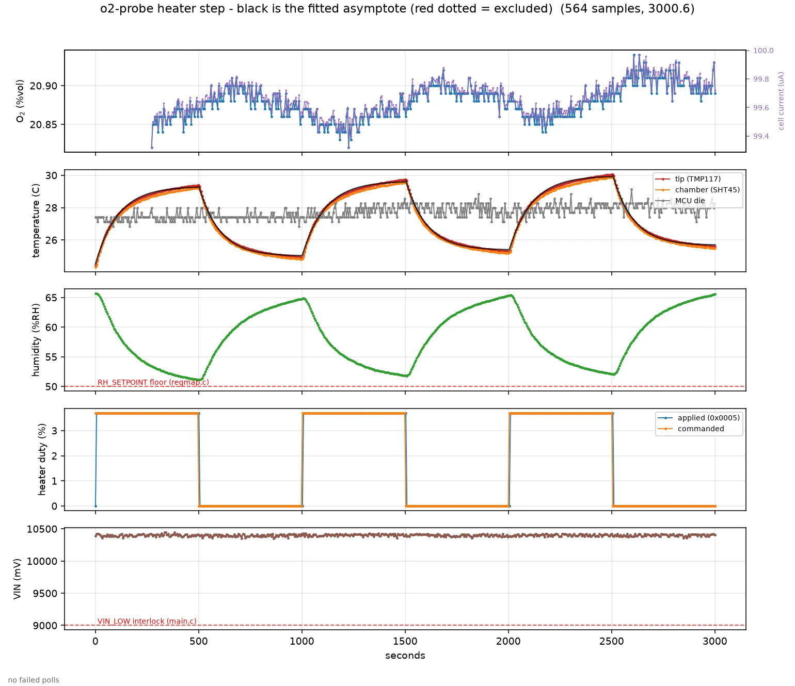
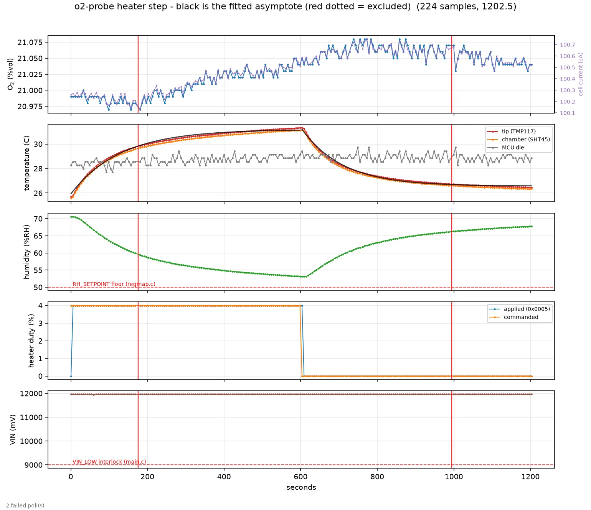

# Measuring the probe's in-pile thermal resistance

**One number decides the battery and the panel, and nobody has measured it:**
θ, the thermal resistance from the heated tip to the surrounding medium, in
K/W. `compostlab/o2-probe/POWER.md` §3.2 sizes the whole power system off an
*assumed* heater duty; this procedure replaces that assumption with a
measurement. It is deliberately cheap — the method was proven on the bench on
2026-09-04 and takes about an hour in the field.

**The procedure is executable.** `firmware/tools/o2p_thermal.py` runs the
square wave, logs it, and fits it, over nothing but the Modbus cable — see §8.
Read §§1–7 for what the number means and §9 for what has to be true before the
heater will run at all.

## 1. What is already known

**Bench reference, 2026-09-04, first article, no ring fitted, still air.** A
fixed 4.00 % duty step, held for 300 s:

```
baseline 26.02 C  ->  settled 30.06 C     DT = 4.04 K
P = duty * VIN^2 / R = 0.0400 * 11.96^2 / 140 = 40.9 mW
theta = 4.04 K / 40.9 mW = 98 K/W          tau ~ 77 s
```

That is the *upper* bound on θ — still air is the worst coupling the probe will
ever see. A potted board in wet compost will be far lower, and that is the whole
question.

Note τ = θ·C implies C ≈ 0.79 J/K, well under the ~7 J/K of the whole board.
The heated volume is local to the tip, as the transverse barrier intends
(`THERMAL-BARRIER.md`). Because τ scales with θ, a better-coupled probe settles
*faster*, so the field measurement is not slower than the bench one.

## 2. Why θ decides the battery

The target rise is set by the cell's 90 %RH rating and the 85 %RH setpoint.
Taking a saturated pile from 100 %RH to 85 %RH at constant vapour pressure needs

```
DT = ln(1/0.85) / (L/(R*T^2))  =  3.3 K at 60 C,  2.7 K at 25 C
```

so **ΔT ≈ 3 K** is the design point. With `P = ΔT/θ` and the probe's 40 mW idle,
POWER.md's own sizing rules (7-day autonomy, AGM at 50 % DoD, 0.7 cold derate,
plus the controller's 2.9 Wh/d) give `Ah = E_day * 1.667`. That formula
reproduces POWER.md's published table exactly, so the mapping below is on the
same footing as the numbers already in that document:

| θ (K/W) | duty for +3 K | load | energy/day | needed | nearest pack | panel |
|---:|---:|---:|---:|---:|---:|---:|
| 98 *(bench, still air)* | 3.0 % | 71 mW | 4.6 Wh | 7.7 Ah | 12 V 8 Ah | ~17 Wp |
| 50 | 5.9 % | 100 mW | 5.3 Wh | 8.8 Ah | 12 V 10 Ah | ~20 Wp |
| 20 | 14.7 % | 190 mW | 7.5 Wh | 12.4 Ah | 12 V 15 Ah | ~30 Wp |
| **10** | **29.4 %** | **340 mW** | **11.1 Wh** | **18.4 Ah** | **12 V 20 Ah** | **~40 Wp** |
| 5 | 58.7 % | 640 mW | 18.3 Wh | 30.4 Ah | 12 V 30 Ah | ~60 Wp |
| 3.4 | 86.4 % | 922 mW | 25.0 Wh | 41.7 Ah | 12 V 45 Ah | ~90 Wp |

Computed with `P_max = VIN^2/R = 11.96^2/140 = 1.022 W` from the measured rail.
POWER.md's own rows use a nominal 12.00 V (its 1068 mW row is 40 mW idle plus
12.00^2/140); feeding 12.00 V into the formula above returns 3.9/10.0/16.1/
28.4 Wh and 6.4/16.7/26.9/47.3 Ah against its published 3.8/10.0/16.2/28.5 Wh
and 7/20/30/50 Ah, i.e. the same table to rounding. The mapping is therefore on
POWER.md's own footing, not a parallel calculation.

The bolded row is what POWER.md's recommended 20 Ah pack implicitly assumes.
**A single measurement moves the recommendation by up to 4x in either
direction.** If θ is nearer 50 K/W the pack and panel are heavily over-bought;
if it is nearer 5 K/W they are under-bought.

## 3. Method

A fixed-duty step response. Two things make the field case harder than the
bench, and both have a fix:

**The pile drifts.** An active pile moves degrees over hours, which contaminates
a single step. So run a **square wave**: at least three cycles of `D` on / `0`
off, each half ≥ 5τ, and take mean(on asymptotes) − mean(off asymptotes). A
linear drift cancels to first order. Fit a drift term as well if the residual
looks sloped.

**There is no unheated reference on the board.** U10 (TMP117, tip) and U12
(SHT45, chamber) sit 6.6 mm apart on the same copper and are one thermal node —
`T_TIP − T_CHAMBER` is structurally ~0 and must **not** be used as ΔT (see
`FAB-READINESS.md`). ΔT is the *change in* `T_TIP` across the step, not a
difference between two sensors. If a neighbouring pile sensor is available, log
it too and subtract it as the drift reference.

## 4. Field procedure (Modbus only, no debugger)

The bench needed SWD because ambient RH was 47 %, below the 50 %RH validation
floor on `RH_SETPOINT`. **In a pile this is unnecessary**: RH is near 100 %, so a
legal setpoint of 50 % saturates the loop and pins duty at the clamp.

1. Record `VIN_MON` (0x0012) and the heater resistance in use. Power is
   `P = duty * VIN^2 / R`; R is `O2P_HW_HEATER_OHM` (140 Ω for RH1‖RH2 on
   the main board) — measure it rather than inherit it if the heater network is
   ever respun. Settled 2026-09-05: the heat source **stays on the main board**;
   an earlier pass that deleted RH1/RH2 for a ring PCB was reverted, so 140 Ω is
   the live figure and the ~1.02 W it draws at 12 V is what tonight's numbers
   rest on.
2. Confirm `FAULTS` (0x0006) has no `HEATER_DISABLED`, and that the build has
   `O2P_HEATER_ENABLE=1`. v0 ships with it 0.
3. Write `RH_SETPOINT` (0x0033) = `5000` (50.00 %RH). The loop now saturates.
4. Square wave, ≥ 3 cycles. Write `HEATER_MAX_DUTY` (0x0035) alternately to `D`
   and `0`. Pick `D` so the expected rise is 2–5 K: start at `2000` (20.00 %)
   and adjust after the first cycle.
5. Log at ≤ 10 s intervals: `T_TIP` (0x0002), `HEATER_DUTY` (0x0005),
   `VIN_MON` (0x0012), `FAULTS` (0x0006). **Read duty back — do not assume it.**
   The controller publishes what the hardware applied, so an interlock that
   refused the command is visible in 0x0005.
6. Restore `HEATER_MAX_DUTY = 0` and `RH_SETPOINT = 8500` when finished. Do
   **not** write the commit magic — this configuration is not meant to persist.

## 5. Analysis

For each half-cycle fit `T(t) = T_inf - (T_inf - T_0) * exp(-t/tau)`, then

```
DT    = mean(T_inf, on) - mean(T_inf, off)
P     = duty * VIN^2 / R          (duty as read back from 0x0005)
theta = DT / P                    [K/W]
C     = tau / theta               [J/K]   sanity check, expect ~1 J/K
```

Report θ with the medium described (moisture, whether the probe was potted and
tubed, depth, and whether the pile was actively aerated). θ is a property of the
installation, not of the board.

## 6. Traps, all of them paid for on 2026-09-04

- **Duty is not commanded directly.** The PI loop targets RH. `HEATER_MAX_DUTY`
  is what pins it, and only while the loop is saturated.
- **Do not use `T_TIP − T_CHAMBER`.** One thermal node; see §3.
- **Do not derive θ from the initial slope.** It underestimates badly — the
  first sample is already well into the response. The bench slope method gave
  0.57 K/% against a true 1.01 K/%, an error of ~2x. Fit the asymptote.
- **Let it actually settle.** At 4 % the bench was still climbing at t = 140 s
  and only flat after ~250 s. Five time constants, verified flat, or the number
  is low.
- **The measurement must be done in the final mechanical configuration** —
  potted, in its tube. The potting and tube are most of the path.
- If you do halt the core over SWD for any reason, the IWDG is ~4.1 s and will
  reset the board mid-measurement unless `DBGMCU_APB_FZ1` bit 12 is set — and
  DBGMCU reads back 0 for every register unless `RCC_APBENR1` DBGEN is set
  first.

## 7. Measured results, and what to do with them

### 7.0 Bench measurements, 2026-09-06

**State the medium with the number — it is a property of the installation, not
of the board.** All three rows below are the *same* installation: a bare probe
standing in an **open** glass jar with a wet paper towel, still room air,
ambient ~25 °C, 12.0 V rail. Open, not sealed: the jar exchanges with the room,
so this is free convection to still room air.

| run | duty | ΔT | θ | τ | C | note |
|---|---:|---:|---:|---:|---:|---|
| 2026-09-06 drift-cancelled, 2 cycles | 3.7 % | 4.45 K | **117.0 K/W** | 110.2 s | 0.94 J/K | all six half-cycles flagged SHORT; only 2 cycles in the mean |
| 2026-09-06 single cycle, 600 s halves | 4.0 % | 4.61 K | **112.9 K/W** | 129.3 s | 1.15 J/K | ON half only 4.6 τ — asymptote extrapolated |
| 2026-09-04 re-fit | — | — | 105 K/W | — | — | that step ran only 3.2 τ; published as 98 |



*Two-cycle drift-cancelled run, θ = 117.0 K/W, τ = 110.2 s. Reproduce with:*
`python3 firmware/tools/o2p_thermal.py --analyze bench-logs/thermal-2026-09-06.csv --vin-mv 12000 --plot out.webp`



*Single cycle, 600 s halves, θ = 112.9 K/W. The ON half is flagged SHORT (4.6 τ),
so its asymptote is extrapolated; the OFF half ran 5.6 τ and fit cleanly.*
`python3 firmware/tools/o2p_thermal.py --analyze bench-logs/o2-recovery-2026-09-06.csv --plot out.webp`

**`--vin-mv 12000` is mandatory on `thermal-2026-09-06.csv` and is not a
cosmetic flag.** That log predates the VIN divider fix, so its `vin_mv` column
reads ~10.5 V for a DMM-confirmed 12.0 V rail. Since `P = duty·VIN²/R`, an
under-read rail under-estimates power and *inflates* θ: analysing that file on
its logged rail returns **155.7 K/W** instead of 117.0, a 33 % error, with no
outward sign that anything is wrong. The tool prints a loud banner when the
override is used and disables the rail-stability exclusion along with it.

**These are preliminary bare-jar estimates, not a range and not a product
bound** (corrected 2026-09-06 after review, which found the table's first ΔT
wrong and the word "range" unearned):

* the ΔT column is the *fitted asymptote difference* of §5, not the raw tip
  excursion. An earlier version of this table put **5.65 K** in that cell, which
  is the whole-run raw range and is inconsistent with its own θ: at 3.7 %, 12.0 V
  and 140 Ω, `P = 38.06 mW`, so θ = 117.0 K/W requires **ΔT = 4.45 K**. The 5.65 K
  figure would have implied 148 K/W.
* every half-cycle in the 117.0 K/W run was flagged `SHORT`, and the 112.9 K/W
  result is a single one-sided cycle with no drift cancellation. Quoting the two
  endpoints as "113–117" presents two different-quality estimates as uncertainty
  bounds. They are not.
* **the claim that free convection to room air is a better heat path than damp
  compost is unsupported**, and contradicts this tool's own expectation that a
  pile couples *better*. Withdrawn; the sign of the pile correction is unknown.

`POWER.md` §3.2 is deliberately NOT updated from these, and that caution must
govern solar sizing until a pile measurement exists.

Provisionally, **θ is of order 110–120 K/W in this bare-jar installation.** The 2026-09-04 value of 98 K/W
is low because the step was far too short (§6, and the tool now warns); re-fitting
the same log with the current estimator gives 105.

**This is an optimistic bound for a buried probe, and the reason is the medium.**
Free convection to room air is a *better* heat path than a probe packed in damp
compost with no air movement. A pile figure will be different and is still
unmeasured — which is why `POWER.md` §3.2 has deliberately **not** been updated
from these numbers. Measure it in a pile before spending the panel budget.

Two supporting numbers from the same runs:

- **`tip − chamber` peaked at +0.220 K across a 5.65 K excursion.** U10 and U12
  are one thermal node, confirming §3: `O2P_HB_DT_LIMIT` (4.00 K) is inert on
  Rev A and cannot fire. The same geometry costs two more interlocks — see
  `DEW-MARGIN-IS-BLIND.md`, which measured the board running **+4.0 K above the
  gas** and the dew-margin channel reporting +1.43 K "safe" while the membrane
  was 2.6 K below the dew point.
- **`tip − die` swung 5.81 K** over the same excursion and is the usable runaway
  reference.

### 7.1 What the heater does to the O₂ channel

Measured 2026-09-06 on the same rig, and it is not zero: a **5.3 K** chamber
excursion (4 % duty, 600 s) moved the cell **+0.3 %**, peaking about five
minutes *after* the heater went off and decaying over roughly **20 minutes**
before settling slightly above where it started. It never undershoots.

Twenty minutes is two orders of magnitude longer than the thermal τ, so this is
a slow cell process, not the cell tracking temperature. It is *not* water
dilution — absolute humidity rose slightly across the step, which pushes O₂ the
other way — and it is not gas exchange with the room, which would pull the
reading toward 20.95 %vol dry and therefore also downward. See
`O2-HUMIDITY-CORRECTION.md` §8.

The consequence for the heater loop: **a duty change quietly costs the oxygen
channel ~0.3 % for twenty minutes.** Rates over windows long compared to that
are unaffected; a level read shortly after a duty change is not.

## 7.2 What to do with the result

Put θ and the conditions into `compostlab/o2-probe/POWER.md` §3.2, replace the
assumed-duty table with the measured row, and re-pick the panel and battery.
If θ lands above ~30 K/W, the recommended 60 Wp / 30 Ah is over-bought and the
saving is real money per node.

Two things the same dataset gives away for free:

- **kp/ki against a real plant.** `heater_ctl.h` says the gain "cannot be
  characterised anywhere but in a real pile"; τ and the DC gain from this test
  are exactly what tuning needs.
- **Whether `dt_max_k` can ever bind.** It cannot on Rev A (§3). If the ring
  is ever respun with the sensors left where they are, it still cannot, and the
  interlock
  should be deleted rather than shipped as decoration.

## 8. Running it: `firmware/tools/o2p_thermal.py`

```sh
cd firmware
python3 tools/o2p_thermal.py --port /dev/cu.usbserial-0001 --preflight
python3 tools/o2p_thermal.py --port /dev/cu.usbserial-0001 run.csv \
        --duty 20 --half 300 --cycles 3 --interval 5
python3 tools/o2p_thermal.py --analyze run.csv --plot run.webp
```

It does §4 and §5 of this document, and it does them in the order that keeps
the answer honest:

**It refuses before it writes.** `--preflight` runs every precondition in §9
and stops. The run does the same checks first and will not touch a register if
any of them fails. This matters more than it sounds: the interlock mask that
would say *why* duty is zero is not published anywhere on the bus (see §9), so
a run that quietly logged zeros would be indistinguishable from a probe with no
heater fitted.

**It keeps the ordinary log running.** Only one process can hold the serial
port, so the 15 s Modbus logger has to stop for the duration — which would put
an hour-long hole in the continuous record exactly where the interesting thing
happened. `--poll-csv` appends every sample to that same file in
`o2p_poll.py`'s schema as well, at the run's own (denser) interval, so the
record carries straight through the experiment. The tool refuses to start if
something still holds the port, rather than interleaving half-lines into
somebody else's CSV. The decoders are imported from `o2p_poll.py` rather than
copied, so the two logs cannot disagree about what a register means.

**It reports applied duty, never commanded duty.** Every row carries both,
from `HEATER_DUTY` (0x0005) and from what the script asked for. If they
disagree, an interlock refused and the run aborts and says so.

**It always puts the registers back.** `HEATER_MAX_DUTY` to 0 and
`RH_SETPOINT` to whatever it was, on every exit path — Ctrl-C, abort,
unhandled exception, SIGTERM. The commit magic (0x003E) is never written: this
configuration is a measurement fixture, and a fixture that survives a power
cycle is a bug. If the restore itself fails it says so and exits 2, because a
probe left with a live `HEATER_MAX_DUTY` keeps heating with nobody watching.

**It aborts on its own.** `T_TIP` at `--tip-max` (default 55 °C, below the
cell's 60 °C rating and well below the firmware's own 80 °C clamp), a
`HEATER_RUNAWAY` latch, the rail falling out of tolerance under load, or
commanded duty that is still not applied after a few samples. An aborted run is
still fitted — partial data beats no data — but the exit status is non-zero so
a wrapper cannot bank the number.

**It excludes half-cycles it cannot believe**, rather than averaging them in.
A segment is dropped if its rail moved by more than `--vin-tol` (2 %, because
`P` scales with `VIN²` and a rail that moved was not one experiment), if it
carries `VIN_LOW`/`VA_LOW`/`HEATER_RUNAWAY`/`I2C_FAIL_TMP`, or if the
exponential misses by more than `--rms-max` (0.30 K; clean bench fits land near
0.04 K). Exclusions are printed with the reason. A *short* half-cycle is
flagged but kept — the fit extrapolates the asymptote, which is exactly what
the slope method could not do.

### How the fit works, and why not scipy

`T(t) = T_inf + (T_0 - T_inf)·exp(-t/τ)`, per half-cycle. τ enters
non-linearly and everything else linearly, so the tool scans τ and solves the
other two exactly at each step. No optimiser, no local minimum, no dependency
beyond the standard library (matplotlib only for `--plot`) — it has to run on
whatever laptop is at the pile.

Two refinements, both of which changed an answer:

- **Asymptote from the tail, but only past 8 τ.** The mean of the last fifth of
  a segment is the more robust estimator once a step has genuinely settled, but
  it is biased *low* by construction — at 5 τ the tail is still climbing
  through 98–99 % of the step, which cost 2.5 K/W on synthetic data with a
  known answer. Below 8 τ the tool uses the fitted asymptote and says so.
- **Re-fit long segments on their last 6 τ.** A segment far longer than τ
  carries thermal history that this step did not cause, and one exponential
  cannot describe both.

`dT` is always the **change in `T_TIP`** across the step, paired against the
mean of the neighbouring OFF asymptotes so a linear drift cancels. It is never
`T_TIP − T_CHAMBER`; see §3.

### Validation

Against synthetic data built from a known θ = 98.0 K/W, τ = 77 s, C = 0.79 J/K
with a 0.5 K/h drift and 5 mK of noise, the tool returns **98.0 K/W** on both
drift-cancelled cycles (95–96 K/W on the first cycle, which has a baseline on
one side only — visible in the `baseline` column).

Re-fitting the real 2026-09-04 bench log (`bench-logs/heater-2026-09-04.csv`,
`--analyze` reads it directly) reproduces the baseline to 0.08 K — 25.94 °C
against the 26.02 °C in §1 — and correctly **excludes** that log's trailing OFF
half, which runs straight through the board being powered down. It returns
**105 K/W against the 98 K/W published in §1**, and the difference is
instructive rather than alarming: that step ran only ~3.2 τ, and §1 took its
last sample as the asymptote. At 3.2 τ a step is ~96 % settled, so 98 K/W is
low by about the amount observed. The two numbers are within the extrapolation
uncertainty of a step that short, and neither is worth defending — **which is
the argument for `--half ≥ 460 s` on the re-run.** Until then, treat §1's 98
K/W as "roughly 100 K/W in still air", not as a measured figure to three
significant digits.

## 9. Preconditions, and the two that block the bench today

Duty is not commandable. The firmware's loop regulates chamber RH, and
`HEATER_MAX_DUTY` only pins the output *while that loop is saturated*. Around
that sit the dozen interlocks in `firmware/src/heater_ctl.h`, any one of which
forces duty to zero.

**Gap worth closing: `HEATER_BLOCK` is not published.** `heater_ctl.h` says the
interlock mask is "published in the diagnostic block as HEATER_BLOCK";
`main.c` computes it into `g_cyc.heater_block`; and there is no such address in
`regmap.h`. `main.c` acknowledges the omission in a comment. So a probe that
refuses to heat reports only `HEATER_DISABLED` — "not driving this cycle,
whatever the reason" — and the reason is exactly what a buried probe cannot be
asked twice for. `o2p_thermal.py` compensates by testing every precondition it
can reach from outside and naming the remainder in its abort message, but that
is a workaround. **A single diagnostic register would replace it.**

What must hold:

| Precondition | Interlock | How to check |
|---|---|---|
| Build has `O2P_HEATER_ENABLE=1` | `HB_NOT_COMPILED` | not observable on the bus; `pio run -e o2probe_heater_enabled` |
| `HEATER_MAX_DUTY` non-zero | `HB_CONFIG_OFF` | the tool sets it |
| TMP117 therm-mode alert armed | `HB_SAFETY` | not observable; `I2C_FAIL_TMP` in `FAULTS` is the proxy |
| Fresh RH, tip and chamber | `HB_NO_RH`/`NO_TIP`/`NO_CHAMBER` | sentinels in 0x0002/0x0003/0x0004 |
| `VIN` ≥ 9000 mV and `VA` in tolerance | `HB_SUPPLY` | `VIN_LOW`/`VA_LOW` in `FAULTS` |
| measured RH **above** `RH_SETPOINT` | (loop simply asks for 0 duty) | 0x0004 against 0x0033 |

**Blocker 1 — the rail. RESOLVED 2026-09-06.** This bench briefly read
`VIN_MON` = **7958 mV** against the 9000 mV `O2P_VIN_LOW_MV` threshold in
`main.c`, setting `VIN_LOW`, clearing `supply_ok` and pinning duty at zero
through `HB_SUPPLY`. It was the supply, not the monitor: with 12 V/1 A back on
the input the same board reads **11950 mV**, against **11960 mV** logged on
2026-09-04. Three very different rails, three correct readings — the VIN
channel is trustworthy, which matters because `P = duty·VIN²/R` and an error
here scales θ by its square. (The reading being flat sample to sample is not
evidence of a stuck channel either: the 91k/10k divider gives 8.1 mV per LSB in
VIN terms against 1.6 mV for `VA_MON`, so a quiet rail parks on one code.)

**Blocker 2 — dry room air.** `o2p_config_valid()` in `regmap.c` accepts
`RH_SETPOINT` only in 50.00–90.00 %RH, and the loop is positive-acting: it asks
for duty only while measured RH is *above* the setpoint. At the 42 %RH on this
bench, **no legal setpoint saturates the loop**, so the heater cannot be
commanded over Modbus at all. This is why §4 says the field case is *easier*
than the bench: in a pile RH is near 100 % and 50 % saturates trivially.

**How much humidity is enough** is not "above 50 %", because heating *lowers*
RH and the constraint is on the *end* of the ON half. At constant absolute
humidity `d(ln RH)/dT = −L/(R_v·T²)`, about −6 % per kelvin near room
temperature — the same Clausius–Clapeyron relation §2 inverts to get its 3 K
design point, run forwards. Leaving 5 %RH of margin above the 50 % setpoint:

| duty | P | ΔT at 98 K/W | chamber must start at |
|---:|---:|---:|---:|
| 2 % | 20 mW | 2.0 K | 62 %RH |
| 3 % | 31 mW | 3.0 K | 66 %RH |
| 4 % | 41 mW | 4.0 K | 70 %RH |

`--preflight` computes that row for whatever `--duty` you pass and prints it.

**Note the duty.** §4 step 4 says "start at `2000` (20.00 %)", and that is right
for a *pile*, where θ near 10–20 K/W makes 20 % a 2–4 K step. On a still-air
bench at ~98 K/W the same command is a **20 K** excursion: past the cell's
60 °C rating, and it would drop chamber RH by a third — through the setpoint,
out of saturation, and the applied duty stops matching the commanded one. The
measurement would destroy its own precondition. The tool defaults to 4 %,
predicts the rise from `--theta-guess` (98 K/W, used *only* for this check and
never in the result), and refuses a duty that would overshoot either limit.

Two ways out on the bench:

1. **Raise the chamber humidity.** Closed box, damp sponge not touching the
   probe, wait for the RH in the table above — ~70 % for the default 4 % duty,
   ~62 % if you drop to 2 %. The tool warns when the margin is under 5 %RH,
   refuses when the step is predicted to fall through the setpoint, and the log
   shows it happening if it does anyway. A closed box is also a fair still-air
   boundary, which is the upper bound θ this measurement is for.
2. **Write the setpoint below the floor over SWD**, bypassing the validator.
   This is what the 2026-09-04 run did. It needs a debugger on the probe, and
   §6's last bullet applies: halting the core resets the board on the ~4.1 s
   IWDG unless `DBGMCU_APB_FZ1` bit 12 is set, and DBGMCU reads back zero until
   `RCC_APBENR1` DBGEN is set first.
