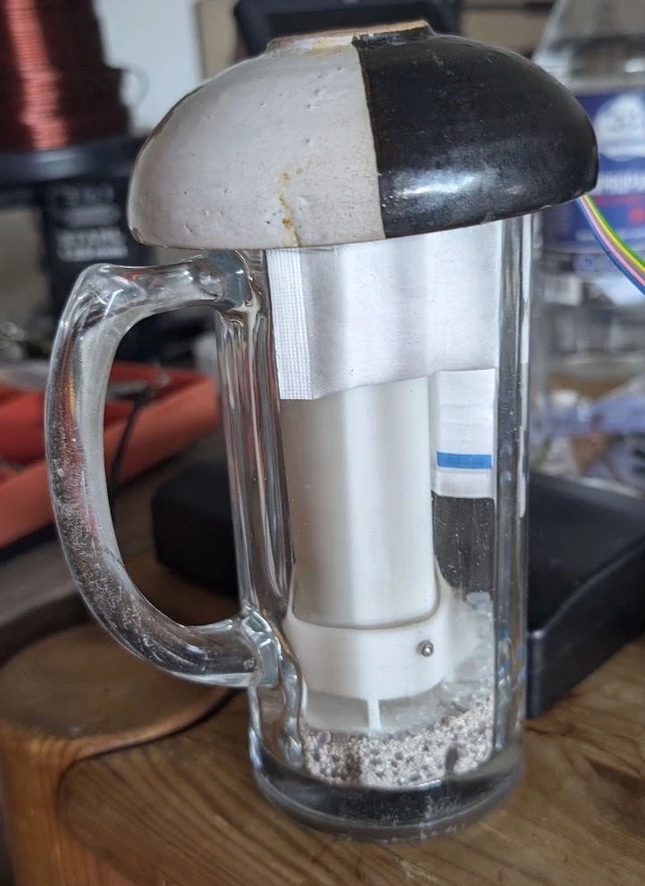

# RH step test 2026-09-07 - run conditions

Recorded during the run, before analysis, so the assumptions are on the record.

| item | value | source |
|---|---|---|
| barometric pressure | **965 hPa** | Fab's phone, 2026-09-07 ~07:00Z |
| pressure basis | taken as **station** (what the cell sees) | ASSUMED, not established. At 1013.25 sea level this implies ~410 m. If 965 were instead sea-level-reduced, station would be ~933.6 hPa at 278 m or ~931.2 at 300 m - at which point the firmware's 930 default would be almost exactly right. Geography cannot settle what the phone app displayed; ask the app. |
| dilution reference | **-0.1052 %/hPa** | -100/(965 - p_w), p_w ~14.3 hPa |
| firmware `ASSUMED_P_HPA` (0x0042) | 930 hPa | 930 is **-3.63 %** relative to 965; the predicted slope magnitude is **+3.82 %** larger at 930. The earlier "wrong by +3.6 %" conflated those. Never set for this location. |
| vessel A | glass tankard, whole body fits, granular desiccant | **vented** - loose ceramic lid, confirmed by photo |
| vessel N | saturated NaCl slurry | not yet used |
| article | assembled, in the unibody | not potted, not tubed |
| logger | `o2p_poll.py` @ 5 s -> `modbus-poll-2026-09-07.csv` | with the 48d3d8b reopen fix |

## Vessel A as built (photo, 2026-09-07)

A glass tankard, granular desiccant filling the base, the probe standing
upright in it, and a heavy two-tone ceramic lid **resting** on the rim.

What the photo settles, and what it raises:

* **VENTING: confirmed adequate.** The lid is a domed ceramic cap sitting loose
  on a glass rim, not a screw closure and not a gasket. It cannot hold a
  pressure difference, which is what section 4b of `RH-STEP-TEST.md` requires -
  a rigid *sealed* vessel changes total pressure instead of partial pressure
  and would predict "no dilution" from a healthy cell. This one is effectively
  vented while still restricting exchange with the room. The open item is
  closed.
* **The probe stands directly IN the desiccant.** Harmless for the dry leg, and
  it maximises coupling to the drying medium, which is why the jar dried as
  fast as it did. **It must NOT be repeated for vessel N.** The board is
  unpotted; over a saturated slurry the probe has to be suspended clear of the
  liquid with something inert underneath, per section 5.
* **Thermal mass and shading are large.** Glass plus a ceramic lid plus a bed of
  desiccant is a substantial thermal buffer, which is part of why the step held
  to 0.12 K. It also means the vessel's own equilibration is slow, and slow
  vessel equilibration is a candidate for the "slow" component in any
  two-exponential fit - see the lag question in
  `rh-step-2026-09-07-live-notes.md`.
* The desiccant is a granular medium of unrecorded type and unknown prior
  loading, so the endpoint RH it holds is whatever it holds. The SHT45 reading
  is the humidity of record; no fixed-point value is claimed for A.

## Open items that affect interpretation

* ~~Venting of the glass jar is unconfirmed.~~ **CLOSED** by the photo above:
  a loose ceramic lid on a glass rim cannot hold a pressure difference.
* **Vessel N is not yet built and must differ from A**: the probe stands in the
  medium in A, which is not acceptable over a slurry.
* **The scheduled SHT45 de-creep pulse fired inside step 1**, 07:16:59Z. The
  window 07:16:56Z to ~07:23:00Z is contaminated - the published RH runs up to
  1.63 %RH low and takes ~325 s to return to the undisturbed curve. Exclude it
  from any fit. See `SHT-DECREEP-MASK-IS-TOO-SHORT.md`.
* **THE CELL IS NOT ON THE PCB** (Fab, 2026-09-07, during the run). The
  footprint has the wrong pin order, so the cell is flying on copper wires
  soldered to the board, and it therefore sits **closer to the membrane than
  the SHT45 does**. This is the single most important interpretive fact in this
  file and it was not known when the timing analysis was done.

  It supplies, as a measured property of the assembly, the explanation the
  review offered as a hypothesis: the two sensors sit at *different depths in
  the diffusion path*, so the cell sees a gas change first because it is nearer
  the gas, not because the SHT45 is slow. Sensirion's v7.3 datasheet gives
  tau63 = 4 s and says the membrane does not alter it, so an intrinsically slow
  SHT45 was never credible anyway.

  Consequences:
  - The "cell leads the SHT45" observation is **explained by geometry** and is
    not evidence about the cell, a film, or the humidity correction.
  - Defining `t = 0` from the SHT45's departure is **circular**: it timestamps
    the step at the downstream sensor.
  - No transport timing measured on this article transfers to the product. The
    cell's position is a bodge, not the design position.
  - The flying leads add exposed unpotted conductor, which is not neutral for
    the leakage-film hypothesis this whole investigation is about.

* **Cell/SHT45 cavity: same open cavity** (Fab, 2026-09-07, during the run).
  This retires the *permanent* form of the "two gas volumes" hypothesis - there
  are not two sealed volumes. **It does NOT establish that the SHT45's `p_w` is
  the cell's `p_w`**, which is how it was first written here and was too strong.
  One open cavity that is drying slowly and is not stirred sustains transient
  spatial gradients, and the entry above says the two sensors are at different
  places in one.

  Corrected 2026-09-07 after review.
